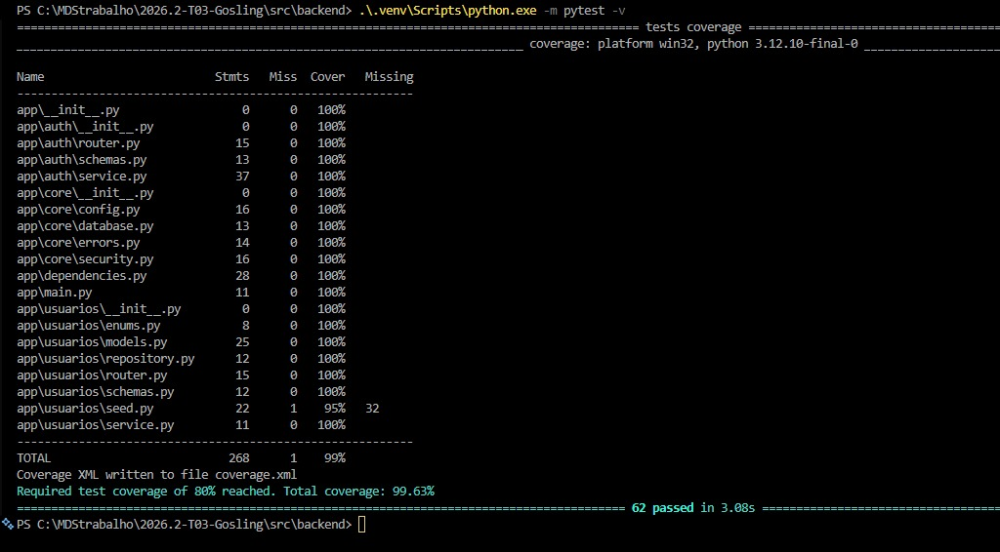
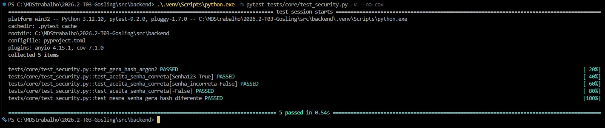
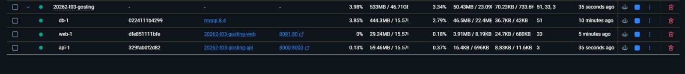
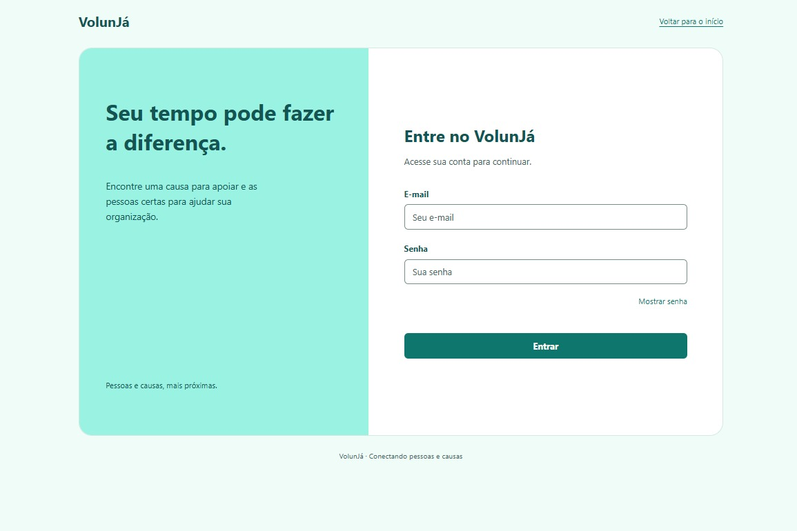
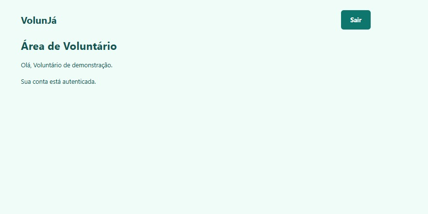
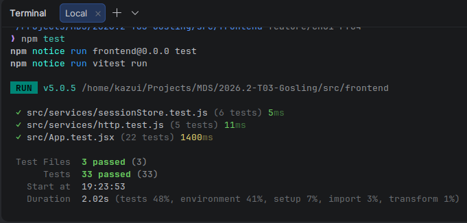

# Testes de autenticação e controle de acesso

**Entregas:** PRs [#57](https://github.com/FGA0138-MDS-Ajax/2026.2-T03-Gosling/pull/57), [#59](https://github.com/FGA0138-MDS-Ajax/2026.2-T03-Gosling/pull/59) e [#61](https://github.com/FGA0138-MDS-Ajax/2026.2-T03-Gosling/pull/61). **Período:** Sprint 7, 28/10 a 03/11/2026. **Requisitos:** RF04, RNF04 e RNF05; relação principal com CT06.

Esta página reúne o roteiro verificado e os prints anexados às entregas de autenticação. As imagens são os arquivos originais das PRs. A execução mais recente com navegador está em [Testes de sistema](sistema.md), incluindo recarga, logout, três perfis e limitação real pelo Nginx.

## Roteiro e resultados

| Caso | Procedimento / resultado esperado | Resultado documentado | Evidência |
| --- | --- | --- | --- |
| Credenciais válidas | Autenticar conta existente, emitir JWT e abrir a área do perfil armazenado no banco. | Implementado e validado na #57; o fluxo dos três perfis também passou no E2E03. | Backend e tela autenticada abaixo; [E2E03](sistema.md#e2e03-acesso-erros-e-tres-perfis). |
| Credenciais inválidas e conta inativa | Recusar a autenticação sem revelar qual credencial falhou. | Testes de autenticação registrados na #57; cenário de senha incorreta no navegador. | Print do backend; E2E03. |
| Proteção por perfil | Recusar acesso sem sessão e impedir uso de área de outro perfil. | Coberto pela API e pelo fluxo de acesso da #57. | [Código e testes da entrega](https://github.com/FGA0138-MDS-Ajax/2026.2-T03-Gosling/pull/57/files); CT06 no [plano](../testes.md#rastreabilidade-do-roteiro-ct01-a-ct14). |
| Hash da senha | Confirmar que a senha correta valida e uma senha diferente é rejeitada. | 5 testes isolados aprovados no print da #57. | Figura A2. |
| Restauração e logout | Recarregar mantendo o titular; sair e remover a sessão do cliente. | Validação registrada na #57; regressões atuais em E2E03/E2E07. | [Relatório de sistema](sistema.md). |
| Entrada institucional e projeto social | Abrir os destinos de cadastro/login e manter o tipo institucional. | #59 documenta 33 testes; #61 documenta 39 no total, incluindo 6 do projeto social. | Figura A6 e descrições das PRs. |

## Backend e segurança

A #57 registra **62 testes de backend aprovados e 99,63% de cobertura** na execução local mostrada abaixo. A meta do projeto é 80%. Esses valores pertencem àquela versão, anterior à expansão da suíte.

[{ loading=lazy width="1024" height="566" }](../assets/testes/pr-57-01.png)

*Figura A1 — Resultado do backend e cobertura da entrega de autenticação. Fonte: [registro original](https://github.com/FGA0138-MDS-Ajax/2026.2-T03-Gosling/pull/57). Clique na imagem para ampliar.*

[{ loading=lazy width="1422" height="302" }](../assets/testes/pr-57-02.png)

*Figura A2 — Verificação isolada do armazenamento seguro de senhas. Fonte: [registro original](https://github.com/FGA0138-MDS-Ajax/2026.2-T03-Gosling/pull/57). Clique na imagem para ampliar.*

## Ambiente e resultado na interface

A entrega também anexou a execução dos serviços Docker, a página de login e uma conta autenticada como voluntário. A tela demonstra o resultado visível; os testes e o CI são as evidências de execução das verificações descritas no roteiro.

[{ loading=lazy width="1600" height="175" }](../assets/testes/pr-57-04.png)

*Figura A3 — Ambiente utilizado na validação da #57. Fonte: [registro original](https://github.com/FGA0138-MDS-Ajax/2026.2-T03-Gosling/pull/57). Clique na imagem para ampliar.*

[{ loading=lazy width="1155" height="770" }](../assets/testes/pr-57-05.png)

*Figura A4 — Interface de entrada da entrega de autenticação. Fonte: [registro original](https://github.com/FGA0138-MDS-Ajax/2026.2-T03-Gosling/pull/57). Clique na imagem para ampliar.*

[{ loading=lazy width="881" height="442" }](../assets/testes/pr-57-06.png)

*Figura A5 — Resultado visível do login de uma conta de voluntário. Fonte: [registro original](https://github.com/FGA0138-MDS-Ajax/2026.2-T03-Gosling/pull/57). Clique na imagem para ampliar.*

## Complemento da entrada institucional

A #59 acrescentou acesso ao cadastro institucional e testes de navegação/estado da sessão. Naquele momento, o formulário definitivo ainda era uma pendência da entrega; não se deve interpretar esse print como prova de cadastro completo da ONG.

[{ loading=lazy width="681" height="326" }](../assets/testes/pr-59-01.png)

*Figura A6 — Testes do frontend no complemento da entrada institucional. Fonte: [registro original](https://github.com/FGA0138-MDS-Ajax/2026.2-T03-Gosling/pull/59). Clique na imagem para ampliar.*

## Continuidade da verificação

Os reparos de sessão entre abas de 20/11 estão em [Regressões da revisão](regressoes.md). A aprovação de uma suíte não comprova funcionalidades de candidatura ou agenda ainda ausentes; a rastreabilidade completa permanece no [roteiro CT01–CT14](../testes.md#rastreabilidade-do-roteiro-ct01-a-ct14).
