# Testes de cadastros e perfis

**Entregas:** PRs [#65](https://github.com/FGA0138-MDS-Ajax/2026.2-T03-Gosling/pull/65), [#67](https://github.com/FGA0138-MDS-Ajax/2026.2-T03-Gosling/pull/67), [#69](https://github.com/FGA0138-MDS-Ajax/2026.2-T03-Gosling/pull/69) e [#72](https://github.com/FGA0138-MDS-Ajax/2026.2-T03-Gosling/pull/72). **Período de integração:** Sprints 8 e 9. **Requisitos:** RF01, RF02, RF06 e RF07; CT01 e CT06.

Os registros abaixo mostram backend, formulários e persistência das entregas originais. Para o cadastro do voluntário em três etapas e a persistência no MySQL da execução de 20/11, consulte [E2E06](sistema.md#e2e06-cadastro-perfil-persistencia-e-isolamento).

## API de organizações — PR 65

| Verificação | Resultado esperado | Resultado registrado |
| --- | --- | --- |
| Cadastro válido | Criar somente uma conta ORGANIZACAO do tipo ONG e persistir os dados institucionais. | A #65 relata cadastro e integração com MySQL verificados. |
| Dados inválidos/duplicados | Validar CNPJ, e-mail, duplicidade e consentimento; não persistir cadastro inválido. | Testes de validação e duplicidade aprovados na suíte da entrega. |
| Consulta/edição própria | Identificar a organização pelo JWT e preservar perfil, tipo e homologação. | Testes de autenticação e isolamento entre organizações registrados como aprovados. |
| Qualidade do código | Passar Ruff e atingir cobertura mínima de 80%. | 113 testes aprovados; cobertura aproximada de 90,8%; Ruff aprovado. |

[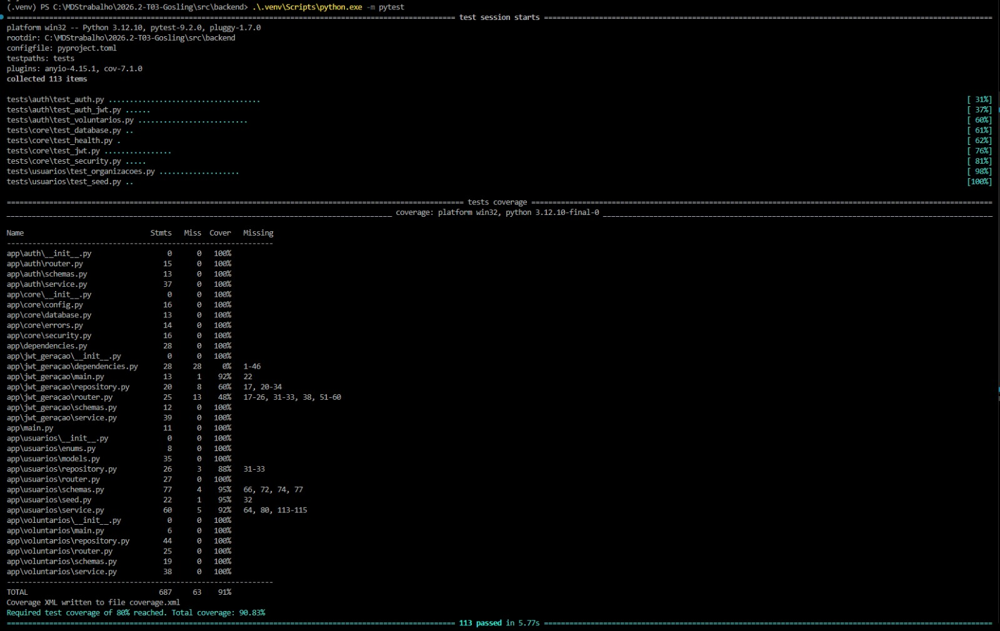{ loading=lazy width="1600" height="1010" }](../assets/testes/pr-65-01.png)

*Figura C1 — Testes e cobertura da API de organizações. Fonte: [registro original](https://github.com/FGA0138-MDS-Ajax/2026.2-T03-Gosling/pull/65). Clique na imagem para ampliar.*

[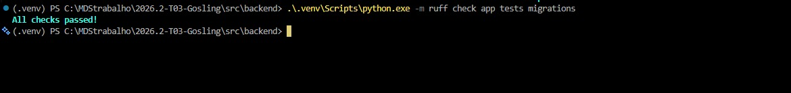{ loading=lazy width="1170" height="139" }](../assets/testes/pr-65-02.png)

*Figura C2 — Análise estática registrada na #65. Fonte: [registro original](https://github.com/FGA0138-MDS-Ajax/2026.2-T03-Gosling/pull/65). Clique na imagem para ampliar.*

A homologação automática foi uma solução provisória explicitada na #65, não a conclusão de RF24. O acompanhamento está em [DT04](../debitos-tecnicos.md#registro-de-tratamento).

## Cadastro da ONG — PR 67

Roteiro documentado: abrir o cadastro institucional, preencher os dados obrigatórios, enviar à API, confirmar a criação da conta e autenticar a organização recém-cadastrada. A PR registra o fluxo com backend e banco reais; os prints abaixo mostram as etapas e os testes do frontend.

[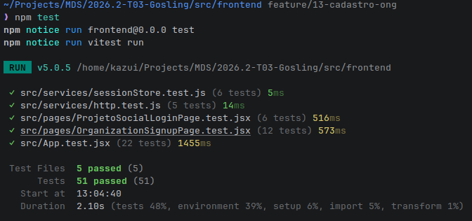{ loading=lazy width="672" height="316" }](../assets/testes/pr-67-01.png)

*Figura C3 — Suíte do frontend anexada à #67. Fonte: [registro original](https://github.com/FGA0138-MDS-Ajax/2026.2-T03-Gosling/pull/67). Clique na imagem para ampliar.*

[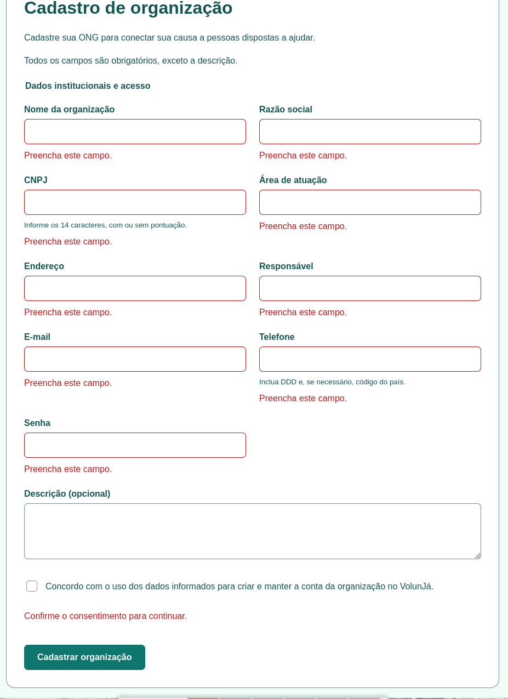{ loading=lazy width="927" height="1275" }](../assets/testes/pr-67-05.png)

*Figura C4 — Dados institucionais no formulário da entrega original. Fonte: [registro original](https://github.com/FGA0138-MDS-Ajax/2026.2-T03-Gosling/pull/67). Clique na imagem para ampliar.*

[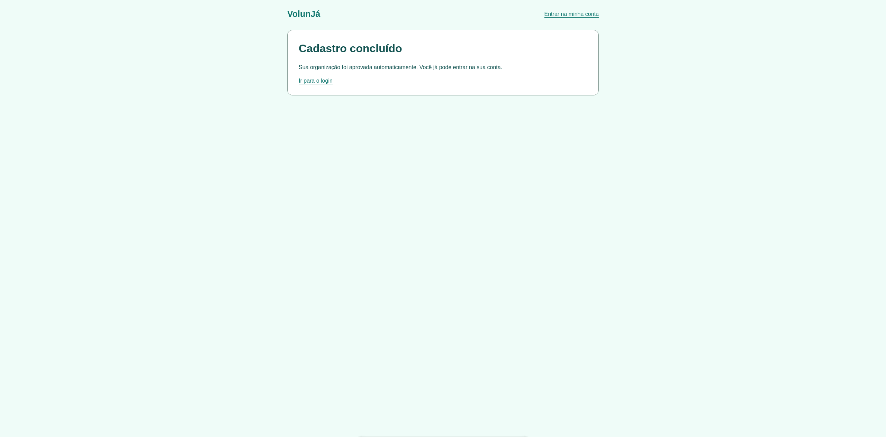{ loading=lazy width="2560" height="1264" }](../assets/testes/pr-67-06.png)

*Figura C5 — Resultado visível após o envio do cadastro. Fonte: [registro original](https://github.com/FGA0138-MDS-Ajax/2026.2-T03-Gosling/pull/67). Clique na imagem para ampliar.*

[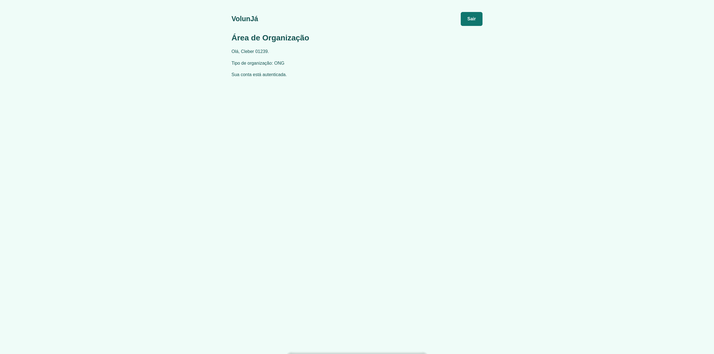{ loading=lazy width="2560" height="1270" }](../assets/testes/pr-67-07.png)

*Figura C6 — Verificação de entrada com a nova conta institucional. Fonte: [registro original](https://github.com/FGA0138-MDS-Ajax/2026.2-T03-Gosling/pull/67). Clique na imagem para ampliar.*

## Perfil institucional — PR 69

| Etapa | Resultado esperado | Resultado registrado na PR |
| --- | --- | --- |
| Consultar | GET /organizacoes/me retorna os dados da ONG autenticada. | Perfil carregado pela API real. |
| Alterar e salvar | PUT /organizacoes/me persiste os campos permitidos e informa sucesso. | Salvamento verificado; tipo e homologação permanecem somente para leitura. |
| Recarregar | Dados salvos continuam visíveis após nova leitura. | Persistência conferida após recarga, com print específico. |
| Falhar no salvamento | Exibir o erro e preservar os dados digitados. | Cenários do componente incluídos nos testes da entrega. |

O print da execução do frontend da #69 mostra **65 testes aprovados**, em seis arquivos. As telas seguintes registram consulta, salvamento e leitura após recarregar.

[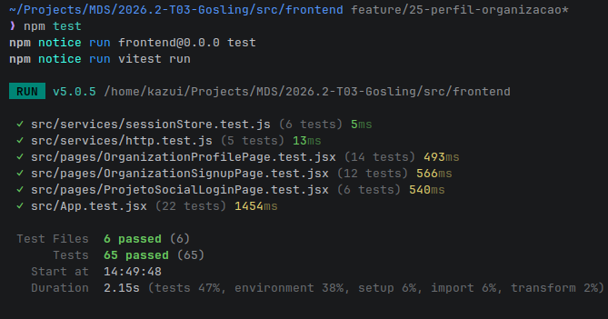{ loading=lazy width="669" height="351" }](../assets/testes/pr-69-01.png)

*Figura C7 — Execução dos testes do frontend do perfil institucional. Fonte: [registro original](https://github.com/FGA0138-MDS-Ajax/2026.2-T03-Gosling/pull/69). Clique na imagem para ampliar.*

[{ loading=lazy width="2560" height="1261" }](../assets/testes/pr-69-05.png)

*Figura C8 — Consulta do perfil autenticado. Fonte: [registro original](https://github.com/FGA0138-MDS-Ajax/2026.2-T03-Gosling/pull/69). Clique na imagem para ampliar.*

[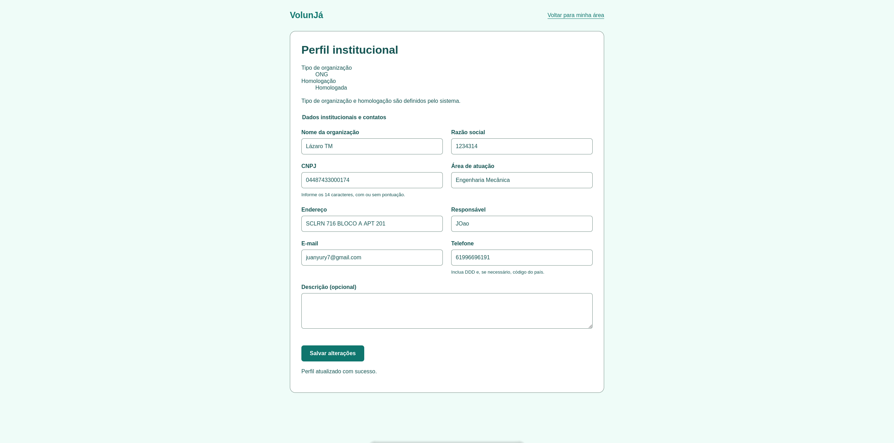{ loading=lazy width="2560" height="1271" }](../assets/testes/pr-69-06.png)

*Figura C9 — Resultado do salvamento no perfil. Fonte: [registro original](https://github.com/FGA0138-MDS-Ajax/2026.2-T03-Gosling/pull/69). Clique na imagem para ampliar.*

[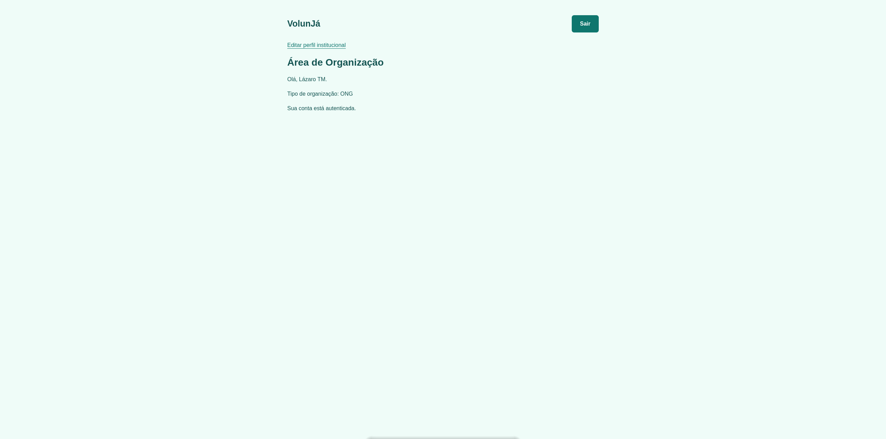{ loading=lazy width="2560" height="1271" }](../assets/testes/pr-69-07.png)

*Figura C10 — Evidência de persistência após nova leitura. Fonte: [registro original](https://github.com/FGA0138-MDS-Ajax/2026.2-T03-Gosling/pull/69). Clique na imagem para ampliar.*

## Integração do voluntário — PR 72

A #72 registra **218 testes de backend, 87,84% de cobertura e 99 testes de frontend**. Seu teste de integração cobre cadastro, sessão inicial, duplicidade, atualização e consulta após novo login, além de rejeitar token incompleto e edição por ONG. A PR foi mesclada em test/fluxos-isolamento; a consolidação na developer ocorreu pela #68.

[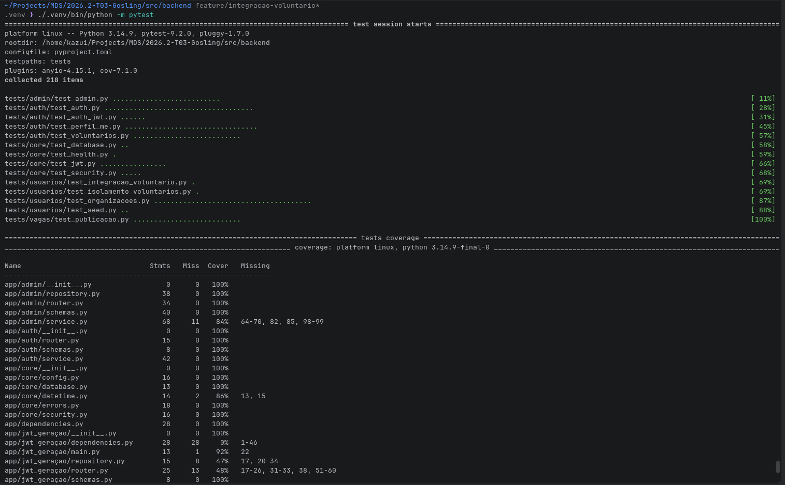{ loading=lazy width="1515" height="939" }](../assets/testes/pr-72-03.png)

*Figura C11 — Execução dos testes do backend da #72, início do relatório. Fonte: [registro original](https://github.com/FGA0138-MDS-Ajax/2026.2-T03-Gosling/pull/72). Clique na imagem para ampliar.*

[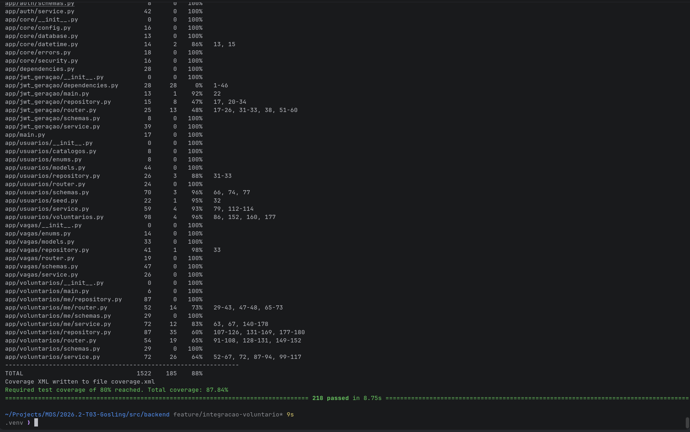{ loading=lazy width="1509" height="945" }](../assets/testes/pr-72-04.png)

*Figura C12 — Continuação e resultado da mesma execução. Fonte: [registro original](https://github.com/FGA0138-MDS-Ajax/2026.2-T03-Gosling/pull/72). Clique na imagem para ampliar.*

[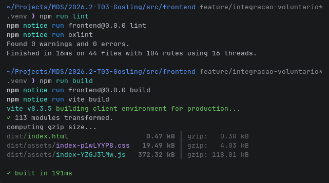{ loading=lazy width="641" height="357" }](../assets/testes/pr-72-05.png)

*Figura C13 — Execução do frontend anexada à #72. Fonte: [registro original](https://github.com/FGA0138-MDS-Ajax/2026.2-T03-Gosling/pull/72). Clique na imagem para ampliar.*

## Verificação de sistema mais recente

O [E2E06](sistema.md#e2e06-cadastro-perfil-persistencia-e-isolamento) testa o cadastro completo no navegador, os dados gravados no MySQL, a edição do perfil, a recarga e o isolamento entre dois voluntários. O [E2E05](sistema.md#e2e05-telefone-e-regras-da-senha-no-cadastro-da-ong) trata máscara de telefone, checklist da senha e acessibilidade do formulário da ONG; esse cenário isolado não efetua o cadastro completo.
