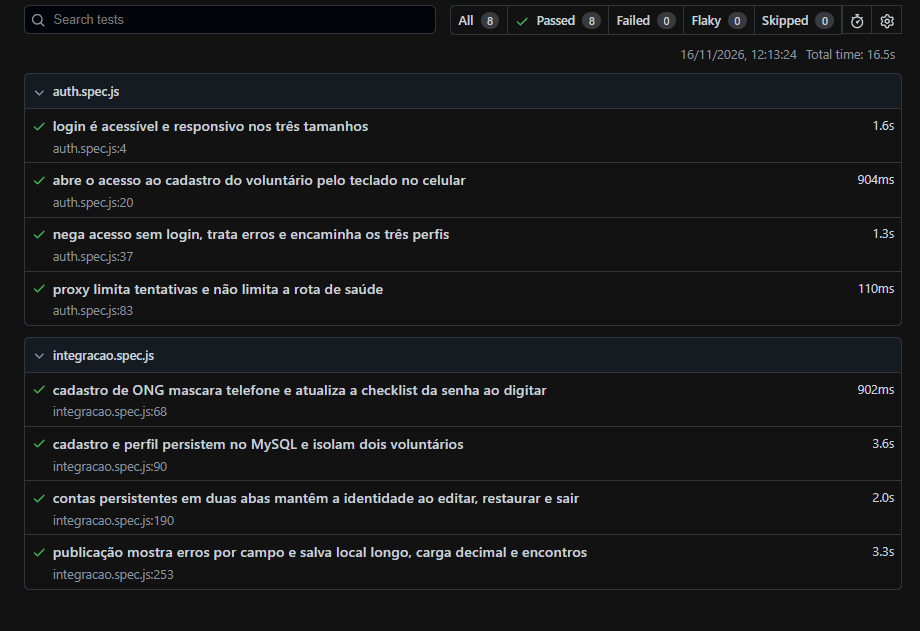
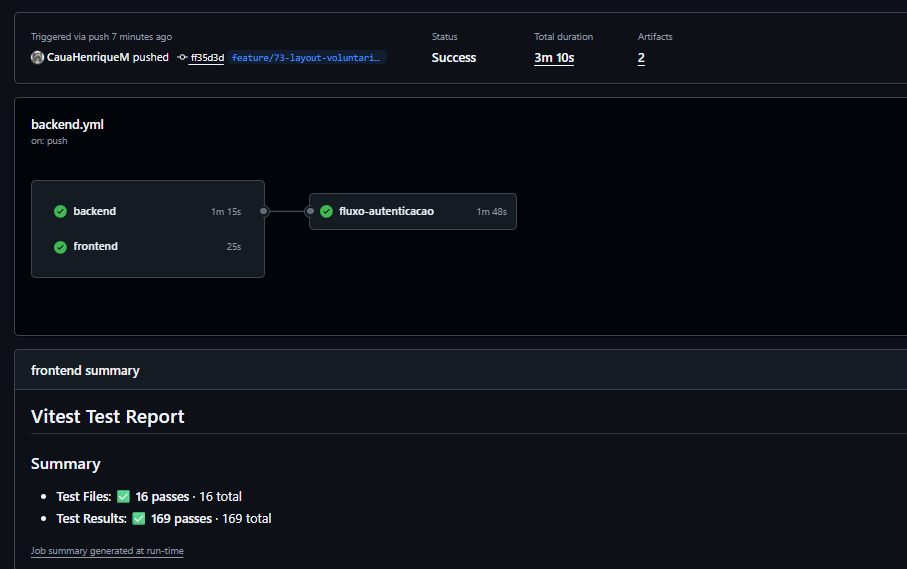
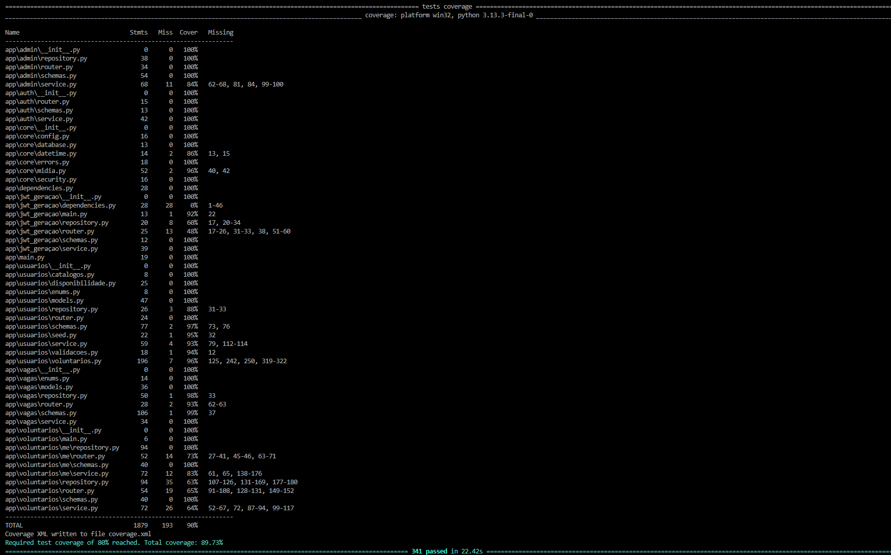
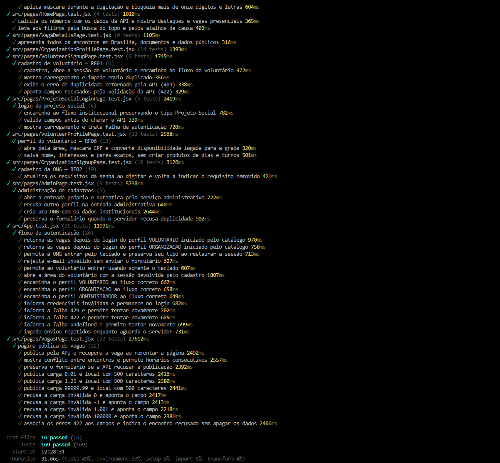
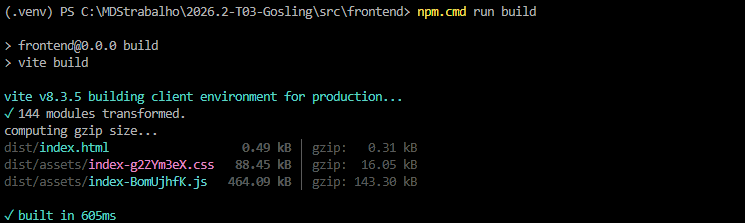

# Testes das correções de sessão e mídia

**Referência:** [PR #88](https://github.com/FGA0138-MDS-Ajax/2026.2-T03-Gosling/pull/88), [commit fe69315](https://github.com/FGA0138-MDS-Ajax/2026.2-T03-Gosling/commit/fe69315), validação em **20/11/2026**. **Situação da PR:** encerrada sem merge na consulta desta atualização; as evidências pertencem ao commit da branch e não representam integração na developer.

Esta página relaciona os comentários da revisão aos reparos, aos testes de regressão e aos resultados observados. Os prints originais da PR foram preservados em uma seção histórica; os números da validação mais recente são os do CI do commit fe69315.

## Reparos e verificação

| Defeito encontrado na revisão | Comportamento esperado após o reparo | Como foi verificado |
| --- | --- | --- |
| Login temporário apagava a sessão lembrada de outra conta. | Conta B funciona na sua aba; a sessão lembrada da conta A permanece após login, recarga e logout de B. | Dois novos testes de armazenamento e ampliação do [E2E07](sistema.md#e2e07-contas-distintas-em-abas). |
| Upload sem publicação ficava armazenado indefinidamente. | Remover mídia sem vínculo depois de 24 h, em verificação horária; permitir nova tentativa enquanto o upload é recente. | 8 casos coletados em [test_limpeza_midia.py](https://github.com/FGA0138-MDS-Ajax/2026.2-T03-Gosling/blob/fe69315/src/backend/tests/vagas/test_limpeza_midia.py), incluindo preservação por estado, avatar/modelo, rollback e falha do banco. |
| Uma publicação podia referenciar imagem local já removida. | Recusar a referência expirada com 422 e pedir nova seleção das imagens. | Regressão de falha/abandono no mesmo arquivo de testes. |
| Falha da coleta podia impedir novas verificações. | Registrar a falha e tentar novamente no próximo intervalo; respeitar o encerramento da API. | Teste da rotina periódica, com falha e cancelamento controlados. |

## Resultado do commit fe69315

| Verificação | Resultado observado |
| --- | --- |
| Backend em SQLite | **391 aprovados; 90,50% de cobertura.** |
| Backend em MySQL 8.4 | **391 aprovados; 90,50% de cobertura.** |
| Frontend | **171 aprovados em 16 arquivos.** |
| Sistema com navegador/MySQL/Nginx | **8 aprovados.** |
| Ruff, lint e build | Aprovados. |

Os três jobs do [GitHub Actions](https://github.com/FGA0138-MDS-Ajax/2026.2-T03-Gosling/actions/runs/44835433519) concluíram com sucesso. O relatório visual e as capturas desta execução estão em [Testes de sistema](sistema.md#resultado-da-execucao). A inspeção de RF09/RF10 foi uma reprodução adicional que encontrou falhas; ela permanece no [registro de defeitos](../debitos-tecnicos.md).

## Prints originais da PR 88

Os anexos seguintes registram a versão anterior às duas correções da revisão e à integração mais recente da developer. O print do CI mostra **169 testes de frontend**, enquanto a execução final acima tem **171**. A descrição original também informava 341 testes de backend e 89,73% de cobertura; esses números não são a contagem atual.

[{ loading=lazy width="920" height="631" }](../assets/testes/pr-88-01.png)

*Figura R1 — Print de testes de sistema originalmente anexado à #88. Fonte: [registro original](https://github.com/FGA0138-MDS-Ajax/2026.2-T03-Gosling/pull/88). Clique na imagem para ampliar.*

[{ loading=lazy width="907" height="569" }](../assets/testes/pr-88-09.png)

*Figura R2 — CI de uma versão anterior da entrega; não é a execução final fe69315. Fonte: [registro original](https://github.com/FGA0138-MDS-Ajax/2026.2-T03-Gosling/pull/88). Clique na imagem para ampliar.*

[{ loading=lazy width="1750" height="1091" }](../assets/testes/pr-88-10.png)

*Figura R3 — Evidência histórica do backend anexada à PR. Fonte: [registro original](https://github.com/FGA0138-MDS-Ajax/2026.2-T03-Gosling/pull/88). Clique na imagem para ampliar.*

[{ loading=lazy width="1202" height="1115" }](../assets/testes/pr-88-11.png)

*Figura R4 — Evidência histórica dos testes de interface. Fonte: [registro original](https://github.com/FGA0138-MDS-Ajax/2026.2-T03-Gosling/pull/88). Clique na imagem para ampliar.*

[{ loading=lazy width="745" height="223" }](../assets/testes/pr-88-12.png)

*Figura R5 — Build da versão mostrada no anexo original. Fonte: [registro original](https://github.com/FGA0138-MDS-Ajax/2026.2-T03-Gosling/pull/88). Clique na imagem para ampliar.*

## Alcance desta validação

A limpeza de mídia é um teste de backend com banco e sistema de arquivos, não um novo fluxo E2E. A coordenação utiliza o único worker da implantação atual; a adoção de múltiplos processos exige coordenação compartilhada. Candidatura, triagem e calendário não são aprovados por esses resultados.
