# Testes de sistema

**Execução:** 20/11/2026, 20h18, horário de Brasília. **Commit:** [fe69315](https://github.com/FGA0138-MDS-Ajax/2026.2-T03-Gosling/commit/fe69315). **Resultado no CI:** **8 aprovados, 0 falhas, 0 ignorados**, duração total de **17,8 s**.

Os cenários usam Chromium/Playwright contra o VolunJá em Docker Compose, com frontend, Nginx, FastAPI e MySQL. Esta página apresenta o roteiro, o resultado observado e as capturas produzidas pela execução. Os identificadores E2E01–E2E08 organizam este relatório; a relação com o roteiro CT01–CT14 está indicada em cada caso.

## Resultado da execução

[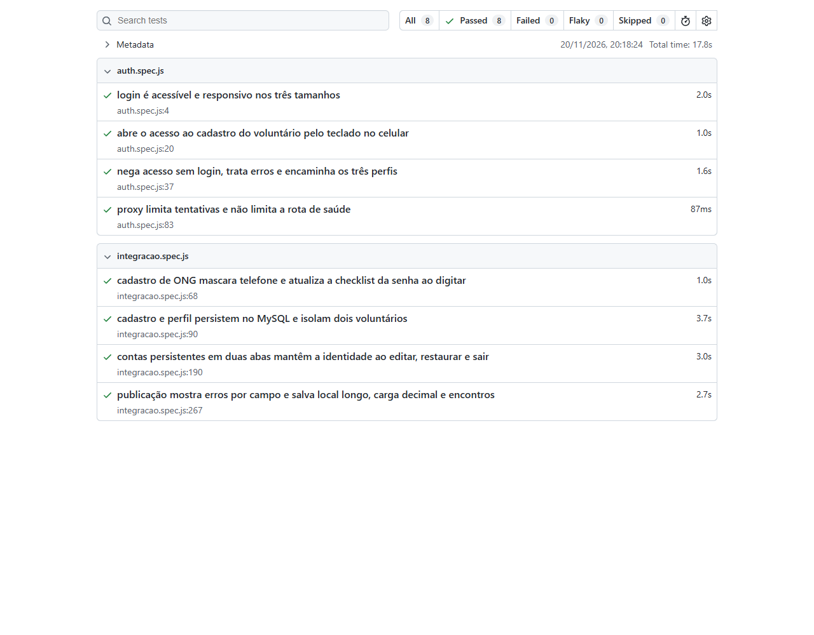{ loading=lazy width="1280" height="1000" }](../assets/testes/sistema-fe69315/relatorio-playwright.png)

*Figura S1 — Relatório real do Playwright, aberto a partir do artefato do CI. Fonte: [artefato da execução no GitHub Actions](https://github.com/FGA0138-MDS-Ajax/2026.2-T03-Gosling/actions/runs/44835433519/artifacts/14678950521), commit fe69315. Clique na imagem para ampliar.*

| Caso | Verificação | Resultado | Duração |
| --- | --- | --- | --- |
| [E2E01](#e2e01-responsividade-e-acessibilidade-do-login) | Login em 360, 768 e 1280 px; axe-core. | Aprovado | 2,0 s |
| [E2E02](#e2e02-cadastro-acessivel-pelo-teclado) | Acesso ao cadastro do voluntário pelo teclado no celular. | Aprovado | 1,0 s |
| [E2E03](#e2e03-acesso-erros-e-tres-perfis) | Proteção de acesso, erro de login, três perfis, recarga e encerramento de sessão. | Aprovado | 1,6 s |
| [E2E04](#e2e04-limite-real-de-tentativas-no-proxy) | Resposta 429 no login e saúde sem bloqueio. | Aprovado | 87 ms |
| [E2E05](#e2e05-telefone-e-regras-da-senha-no-cadastro-da-ong) | Máscara de telefone, checklist da senha e axe-core. | Aprovado | 1,0 s |
| [E2E06](#e2e06-cadastro-perfil-persistencia-e-isolamento) | Cadastro em etapas, edição, persistência no MySQL e isolamento. | Aprovado | 3,7 s |
| [E2E07](#e2e07-contas-distintas-em-abas) | Contas persistente/temporária em abas distintas. | Aprovado | 3,0 s |
| [E2E08](#e2e08-publicacao-validacoes-e-encontros) | Publicação, erros por campo, local longo, carga decimal e encontros. | Aprovado | 2,7 s |

Fontes: [execução completa](https://github.com/FGA0138-MDS-Ajax/2026.2-T03-Gosling/actions/runs/44835433519), [recorte textual do log](../assets/testes/sistema-fe69315/execucao-ci.txt) e [artefato original](https://github.com/FGA0138-MDS-Ajax/2026.2-T03-Gosling/actions/runs/44835433519/artifacts/14678950521). As capturas foram incorporadas ao repositório para permanecerem disponíveis no Pages após a expiração do artefato no Actions.

## Ambiente e preparação

| Item | Configuração utilizada |
| --- | --- |
| Sistema | Serviços web, api e db do Docker Compose; Nginx na frente da API. |
| Banco | MySQL 8.4 com as migrações Alembic aplicadas. |
| Contas | Perfis fictícios de voluntário, ONG e administrador; contas próprias criadas e removidas pelas fixtures dos fluxos de integração. |
| Navegador | Chromium, Playwright, um worker e nenhuma repetição automática da suíte. |
| Segurança dos dados de teste | Nomes, e-mails, CPF/CNPJ e senhas utilizados são dados fictícios de demonstração. |
| Sessões | Em E2E07 o login é encaminhado à API real para isolar o teste da sessão; o limite do Nginx é exercitado separadamente em E2E04. |
| Acessibilidade | axe-core e navegação por teclado nos fluxos explicitados; não é a coleta de usabilidade com pessoas da métrica M6. |

## E2E01 — Responsividade e acessibilidade do login

**Relação:** RNF02/RNF03. **Implementação:** [auth.spec.js:4](https://github.com/FGA0138-MDS-Ajax/2026.2-T03-Gosling/blob/fe69315/src/frontend/e2e/auth.spec.js#L4).

**Roteiro:** abrir o login em larguras de 1280, 768 e 360 px; conferir o título, ausência de rolagem horizontal e resultado do axe-core nas regras WCAG 2 A/AA e 2.1 AA.

**Esperado:** formulário visível e nenhuma violação automatizada nas verificações executadas. **Obtido:** cenário aprovado nos três tamanhos; as capturas seguintes pertencem à mesma execução.

[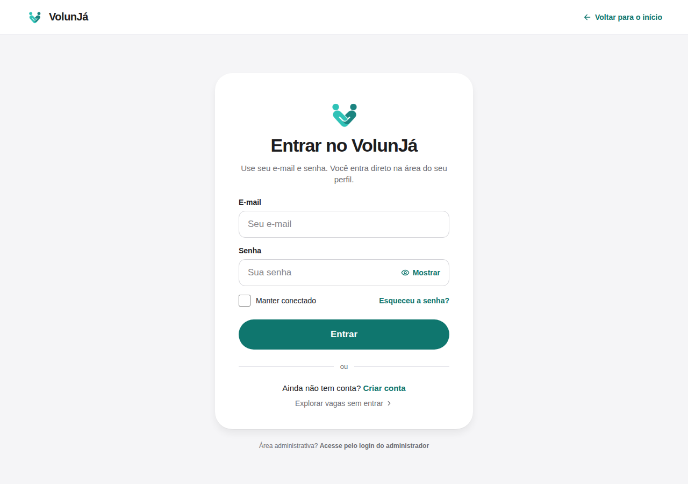{ loading=lazy width="1280" height="900" }](../assets/testes/sistema-fe69315/login-1280.png)

*Figura S2 — Login em largura de desktop. Fonte: [artefato da execução no GitHub Actions](https://github.com/FGA0138-MDS-Ajax/2026.2-T03-Gosling/actions/runs/44835433519/artifacts/14678950521), commit fe69315. Clique na imagem para ampliar.*

[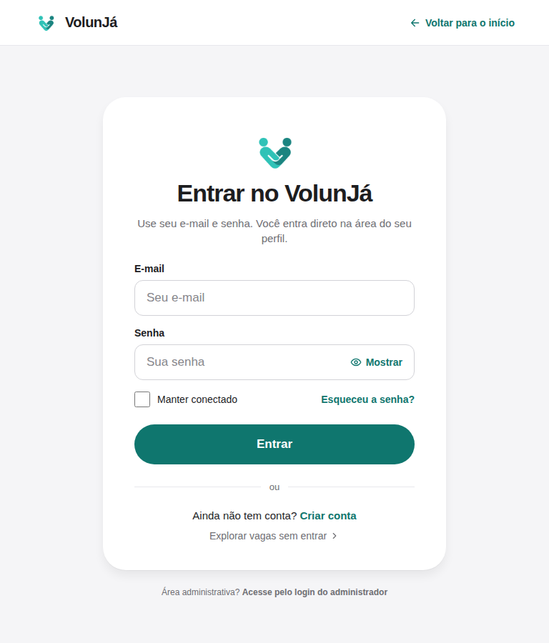{ loading=lazy width="768" height="900" }](../assets/testes/sistema-fe69315/login-768.png)

*Figura S3 — Login em largura de tablet. Fonte: [artefato da execução no GitHub Actions](https://github.com/FGA0138-MDS-Ajax/2026.2-T03-Gosling/actions/runs/44835433519/artifacts/14678950521), commit fe69315. Clique na imagem para ampliar.*

[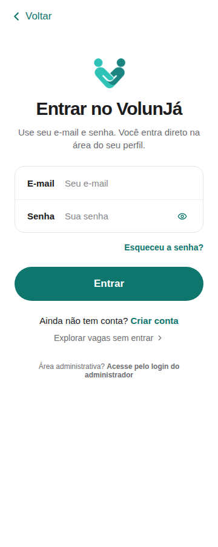{ loading=lazy width="360" height="900" }](../assets/testes/sistema-fe69315/login-360.png)

*Figura S4 — Login em largura de celular. Fonte: [artefato da execução no GitHub Actions](https://github.com/FGA0138-MDS-Ajax/2026.2-T03-Gosling/actions/runs/44835433519/artifacts/14678950521), commit fe69315. Clique na imagem para ampliar.*

## E2E02 — Cadastro acessível pelo teclado

**Relação:** acesso ao CT01 e RNF03. **Implementação:** [auth.spec.js:20](https://github.com/FGA0138-MDS-Ajax/2026.2-T03-Gosling/blob/fe69315/src/frontend/e2e/auth.spec.js#L20).

**Roteiro:** em 360 px, focar Criar conta, pressionar Enter, escolher Continuar como voluntário pelo teclado e verificar a rota de cadastro; executar axe-core e voltar ao login.

**Esperado:** navegação alcança o cadastro sem mouse e retorna ao login; nenhuma violação automatizada no recorte verificado. **Obtido:** aprovado. Este caso valida o acesso; a criação efetiva da conta está em E2E06.

[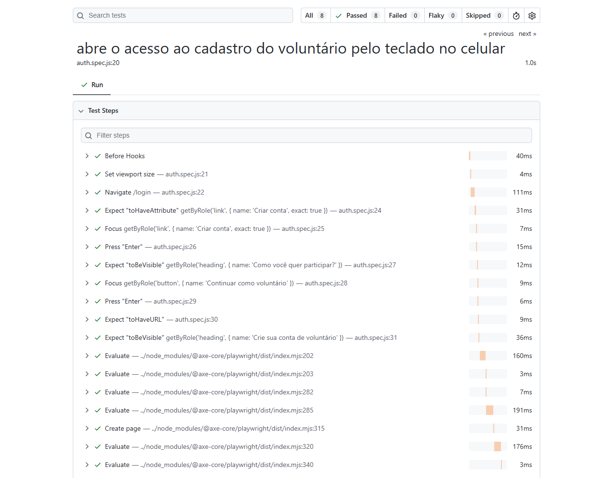{ loading=lazy width="1280" height="1000" }](../assets/testes/sistema-fe69315/e2e-02-relatorio.png)

*Figura S5 — Resultado e passos registrados do E2E02. Fonte: [artefato da execução no GitHub Actions](https://github.com/FGA0138-MDS-Ajax/2026.2-T03-Gosling/actions/runs/44835433519/artifacts/14678950521), commit fe69315. Clique na imagem para ampliar.*

## E2E03 — Acesso, erros e três perfis

**Relação:** CT06, RF04 e RNF05. **Implementação:** [auth.spec.js:37](https://github.com/FGA0138-MDS-Ajax/2026.2-T03-Gosling/blob/fe69315/src/frontend/e2e/auth.spec.js#L37).

**Roteiro:** tentar acessar a área do voluntário sem sessão; enviar senha incorreta; autenticar voluntário, ONG e administrador; recarregar cada área; invalidar o token do voluntário e conferir o 401 global; sair das demais contas.

**Esperado:** redirecionamento ao login sem sessão, mensagem de credencial inválida, área correspondente ao perfil, restauração após recarga e remoção do token ao encerrar a sessão. **Obtido:** todas as verificações do cenário aprovadas.

[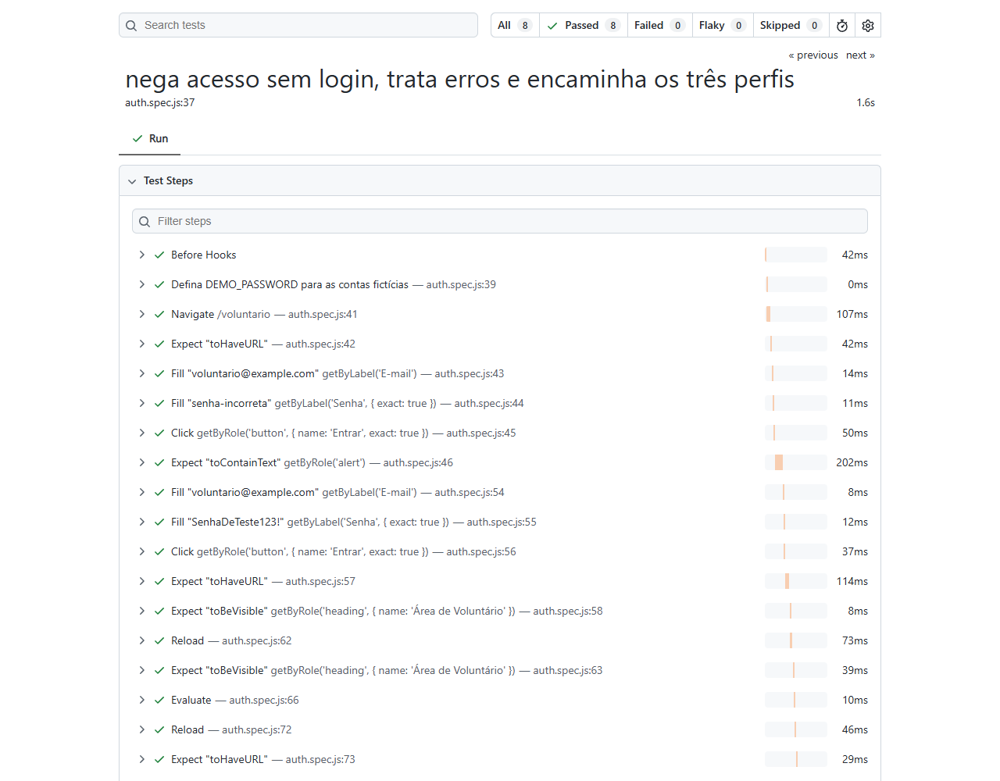{ loading=lazy width="1280" height="1000" }](../assets/testes/sistema-fe69315/e2e-03-relatorio.png)

*Figura S6 — Execução registrada do E2E03. Fonte: [artefato da execução no GitHub Actions](https://github.com/FGA0138-MDS-Ajax/2026.2-T03-Gosling/actions/runs/44835433519/artifacts/14678950521), commit fe69315. Clique na imagem para ampliar.*

## E2E04 — Limite real de tentativas no proxy

**Relação:** RF04 e segurança da autenticação. **Implementação:** [auth.spec.js:83](https://github.com/FGA0138-MDS-Ajax/2026.2-T03-Gosling/blob/fe69315/src/frontend/e2e/auth.spec.js#L83).

**Roteiro:** enviar tentativas inválidas ao login pelo Nginx, variando X-Forwarded-For, até obter 429 dentro do limite de 20 pedidos do teste; consultar a rota de saúde na sequência.

**Esperado:** antes do bloqueio, 401; ao atingir o limitador, 429; GET /api/v1/health continua com 200. **Obtido:** aprovado, com as asserções e requisições registradas no relatório.

[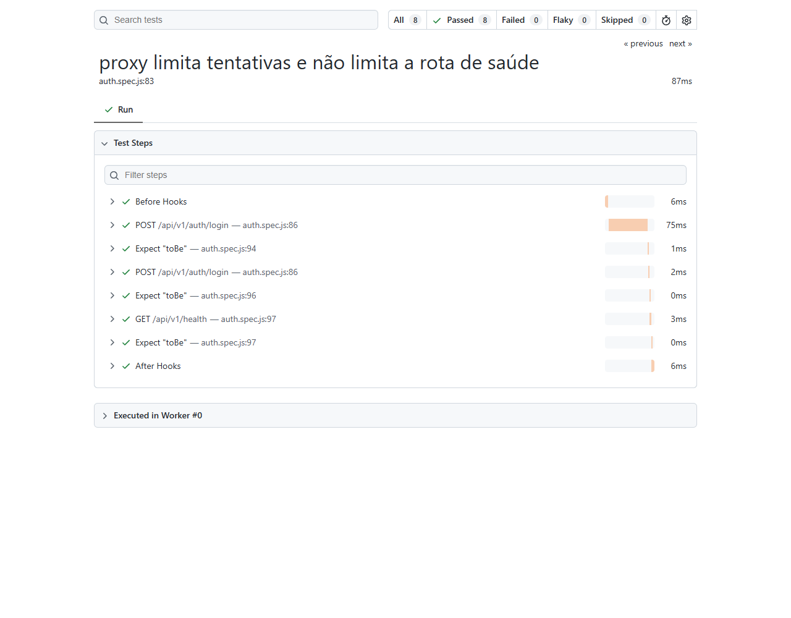{ loading=lazy width="1280" height="1000" }](../assets/testes/sistema-fe69315/e2e-04-relatorio.png)

*Figura S7 — Execução registrada do E2E04. Fonte: [artefato da execução no GitHub Actions](https://github.com/FGA0138-MDS-Ajax/2026.2-T03-Gosling/actions/runs/44835433519/artifacts/14678950521), commit fe69315. Clique na imagem para ampliar.*

## E2E05 — Telefone e regras da senha no cadastro da ONG

**Relação:** validações de RF02, RNF02/RNF03. **Implementação:** [integracao.spec.js:68](https://github.com/FGA0138-MDS-Ajax/2026.2-T03-Gosling/blob/fe69315/src/frontend/e2e/integracao.spec.js#L68).

**Roteiro:** digitar telefone maior que o permitido, conferir a máscara e o limite; substituir por telefone fixo; digitar senha e acompanhar cada requisito; inserir/remover espaço e executar axe-core.

**Esperado:** máscara correta para fixo/celular, máximo de 11 dígitos, checklist atualizado durante a digitação e nenhuma violação automatizada no formulário analisado. **Obtido:** aprovado. O envio completo do cadastro institucional está documentado na [PR #67](cadastros-perfis.md#cadastro-da-ong-pr-67).

[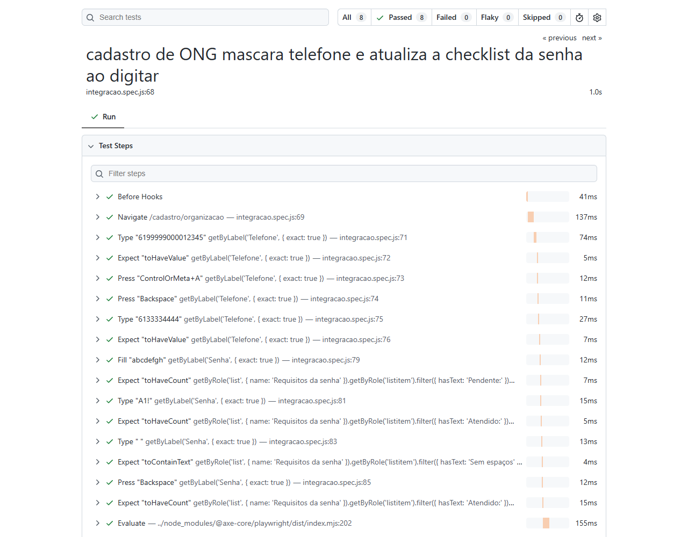{ loading=lazy width="1280" height="1000" }](../assets/testes/sistema-fe69315/e2e-05-relatorio.png)

*Figura S8 — Execução registrada do E2E05. Fonte: [artefato da execução no GitHub Actions](https://github.com/FGA0138-MDS-Ajax/2026.2-T03-Gosling/actions/runs/44835433519/artifacts/14678950521), commit fe69315. Clique na imagem para ampliar.*

## E2E06 — Cadastro, perfil, persistência e isolamento

**Relação:** CT01, CT06, RF01 e RF06. **Implementação:** [integracao.spec.js:90](https://github.com/FGA0138-MDS-Ajax/2026.2-T03-Gosling/blob/fe69315/src/frontend/e2e/integracao.spec.js#L90).

**Roteiro:**

1. Preencher os dados fictícios do voluntário, consentimento, interesses e disponibilidade; enviar o cadastro e conferir HTTP 201 e sessão inicial.
2. Editar nome, telefone, cidade, biografia, interesses e carga semanal; salvar e recarregar.
3. Conferir a grade semanal e os dados retornados pela API; enviar atualização legada e dados inválidos para verificar preservação/rejeição.
4. Criar outro voluntário e tentar direcionar consulta/edição por parâmetro de ID; conferir que a identidade vem do JWT, a outra conta permanece inalterada e perfis indevidos são recusados.

**Esperado:** conta persistida, perfil atualizado após recarga, dados privados protegidos e isolamento entre titulares. **Obtido:** cenário aprovado, incluindo HTTP 201, validação de persistência e negativas 401/403/422 previstas no teste.

[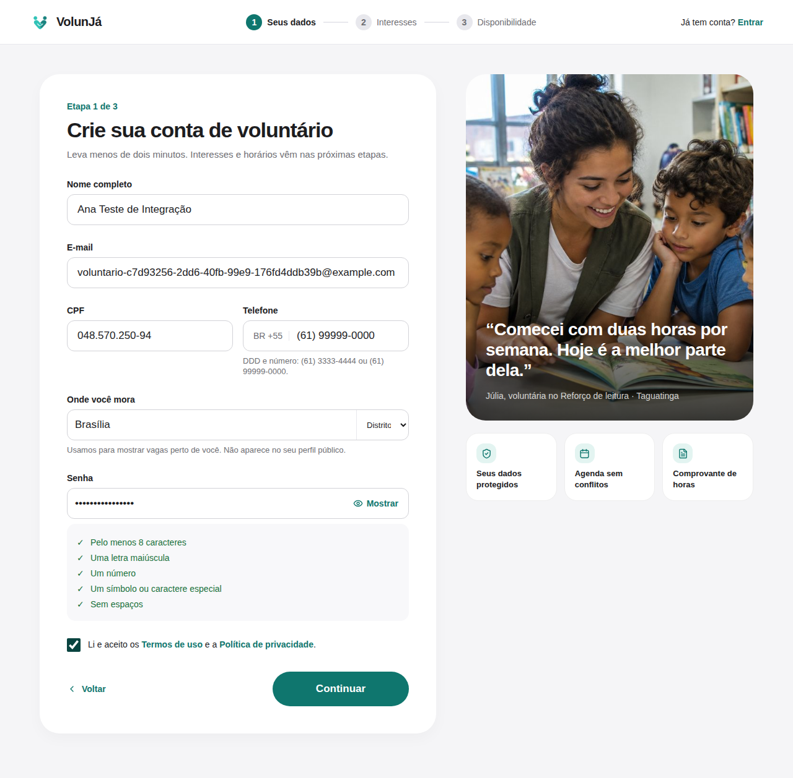{ loading=lazy width="1280" height="1258" }](../assets/testes/sistema-fe69315/cadastro-voluntario-dados.png)

*Figura S9 — Dados pessoais antes do envio do cadastro. Fonte: [artefato da execução no GitHub Actions](https://github.com/FGA0138-MDS-Ajax/2026.2-T03-Gosling/actions/runs/44835433519/artifacts/14678950521), commit fe69315. Clique na imagem para ampliar.*

[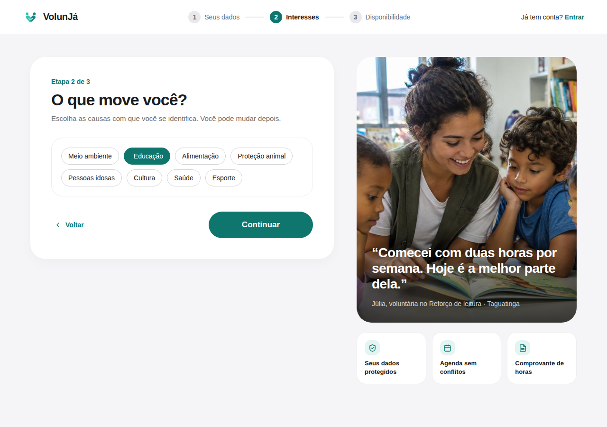{ loading=lazy width="1280" height="900" }](../assets/testes/sistema-fe69315/cadastro-voluntario-interesses.png)

*Figura S10 — Etapa de interesses do mesmo cadastro. Fonte: [artefato da execução no GitHub Actions](https://github.com/FGA0138-MDS-Ajax/2026.2-T03-Gosling/actions/runs/44835433519/artifacts/14678950521), commit fe69315. Clique na imagem para ampliar.*

[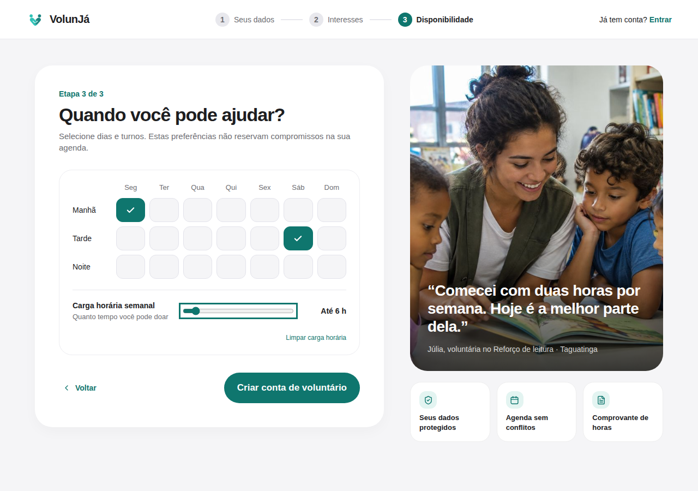{ loading=lazy width="1280" height="900" }](../assets/testes/sistema-fe69315/cadastro-voluntario-disponibilidade.png)

*Figura S11 — Etapa de disponibilidade antes da criação da conta. Fonte: [artefato da execução no GitHub Actions](https://github.com/FGA0138-MDS-Ajax/2026.2-T03-Gosling/actions/runs/44835433519/artifacts/14678950521), commit fe69315. Clique na imagem para ampliar.*

[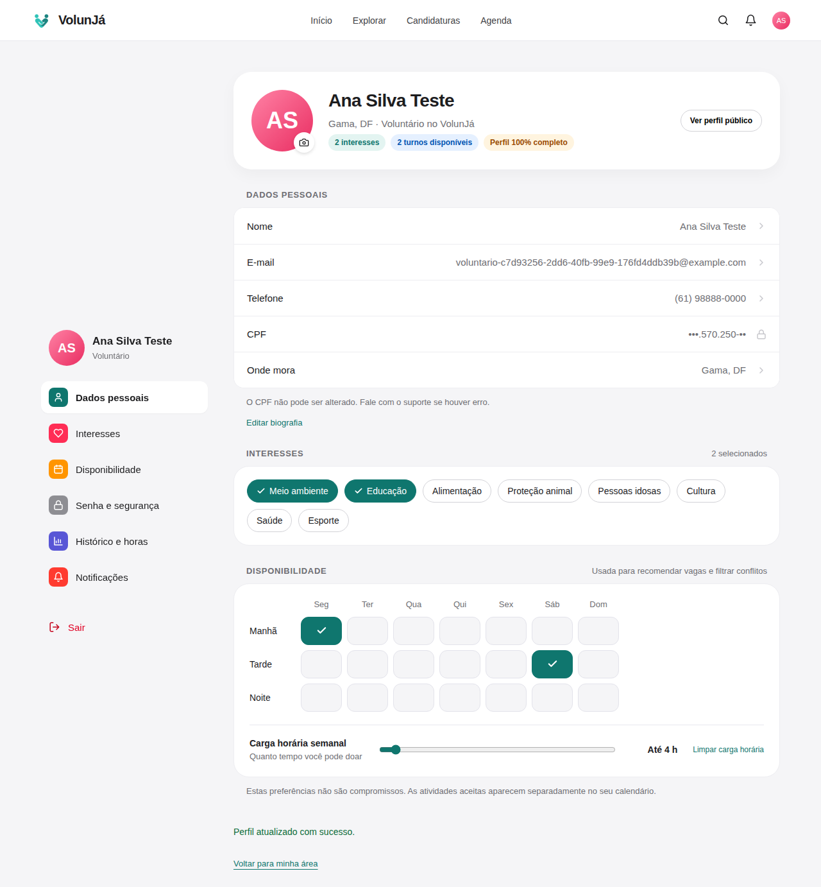{ loading=lazy width="1280" height="1382" }](../assets/testes/sistema-fe69315/perfil-voluntario-salvo.png)

*Figura S12 — Resultado da edição do perfil persistido. Fonte: [artefato da execução no GitHub Actions](https://github.com/FGA0138-MDS-Ajax/2026.2-T03-Gosling/actions/runs/44835433519/artifacts/14678950521), commit fe69315. Clique na imagem para ampliar.*

[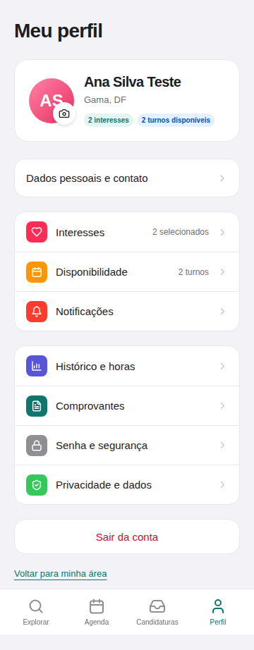{ loading=lazy width="360" height="922" }](../assets/testes/sistema-fe69315/perfil-voluntario-celular.png)

*Figura S13 — Perfil após recarga, em largura de celular. Fonte: [artefato da execução no GitHub Actions](https://github.com/FGA0138-MDS-Ajax/2026.2-T03-Gosling/actions/runs/44835433519/artifacts/14678950521), commit fe69315. Clique na imagem para ampliar.*

## E2E07 — Contas distintas em abas

**Relação:** RF04, RF06 e CT06; regressão da revisão de sessão. **Implementação:** [integracao.spec.js:190](https://github.com/FGA0138-MDS-Ajax/2026.2-T03-Gosling/blob/fe69315/src/frontend/e2e/integracao.spec.js#L190).

**Roteiro:** criar duas contas; manter uma aba de login aberta antes de lembrar a primeira; entrar com a segunda sem persistência; recarregar e sair sem apagar a conta lembrada; abrir outra sessão persistente, editar o perfil da primeira e conferir a preservação da segunda; recarregar e sair das abas.

**Esperado:** cada aba mantém o próprio titular; o login temporário não remove a sessão lembrada de outra conta; editar um perfil não altera o outro. **Obtido:** aprovado, incluindo as novas asserções da correção fe69315.

[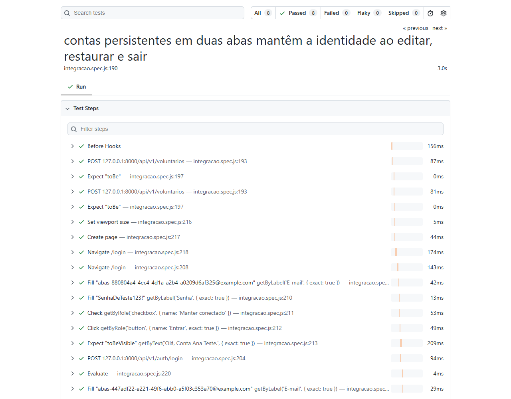{ loading=lazy width="1280" height="1000" }](../assets/testes/sistema-fe69315/e2e-07-relatorio.png)

*Figura S14 — Execução registrada do E2E07, após a correção de sessão. Fonte: [artefato da execução no GitHub Actions](https://github.com/FGA0138-MDS-Ajax/2026.2-T03-Gosling/actions/runs/44835433519/artifacts/14678950521), commit fe69315. Clique na imagem para ampliar.*

## E2E08 — Publicação, validações e encontros

**Relação:** CT02 e validação de ocorrências de CT14; RF08 e RF14. **Implementação:** [integracao.spec.js:267](https://github.com/FGA0138-MDS-Ajax/2026.2-T03-Gosling/blob/fe69315/src/frontend/e2e/integracao.spec.js#L267).

**Pré-condição:** ONG fictícia criada pela API administrativa; sessão emitida pela API real e revalidada em /auth/me.

**Roteiro:**

1. Abrir Publicar vaga e enviar vazio; verificar mensagem, aria-invalid, descrição acessível e foco no primeiro erro.
2. Preencher descrição e atividades, local maior que 200 caracteres, carga de 1,25 h e dois encontros.
3. Publicar, recarregar e abrir os detalhes; conferir local completo, carga decimal, quantidade de encontros e conversão UTC/Brasília.
4. Abrir um contexto de visitante e confirmar que a vaga permanece pública, sem botão de publicação.

**Esperado:** formulário inválido não publica; dados válidos são gravados no MySQL e exibidos após recarga, com os dois intervalos corretos. **Obtido:** aprovado. Edição com candidatura ativa e conflito entre candidaturas continuam fora deste cenário.

[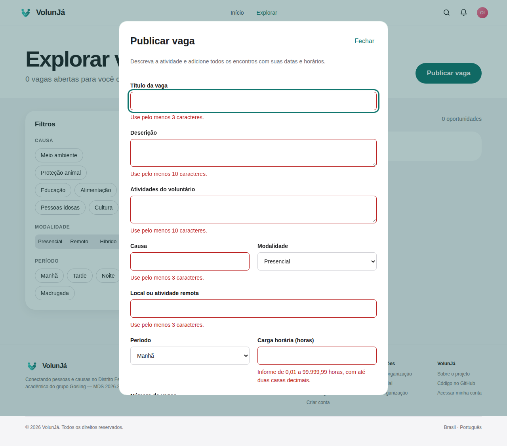{ loading=lazy width="1280" height="1126" }](../assets/testes/sistema-fe69315/vagas-erros-por-campo.png)

*Figura S15 — Validação do formulário antes da publicação. Fonte: [artefato da execução no GitHub Actions](https://github.com/FGA0138-MDS-Ajax/2026.2-T03-Gosling/actions/runs/44835433519/artifacts/14678950521), commit fe69315. Clique na imagem para ampliar.*

[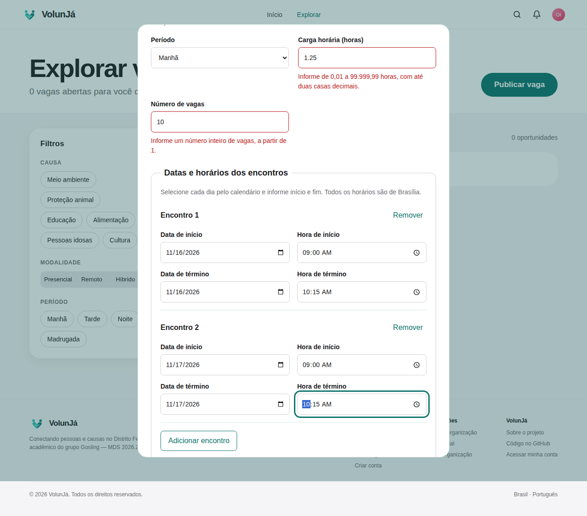{ loading=lazy width="1280" height="1126" }](../assets/testes/sistema-fe69315/vagas-limites-e-encontros.png)

*Figura S16 — Dados válidos e múltiplos encontros antes do envio. Fonte: [artefato da execução no GitHub Actions](https://github.com/FGA0138-MDS-Ajax/2026.2-T03-Gosling/actions/runs/44835433519/artifacts/14678950521), commit fe69315. Clique na imagem para ampliar.*

[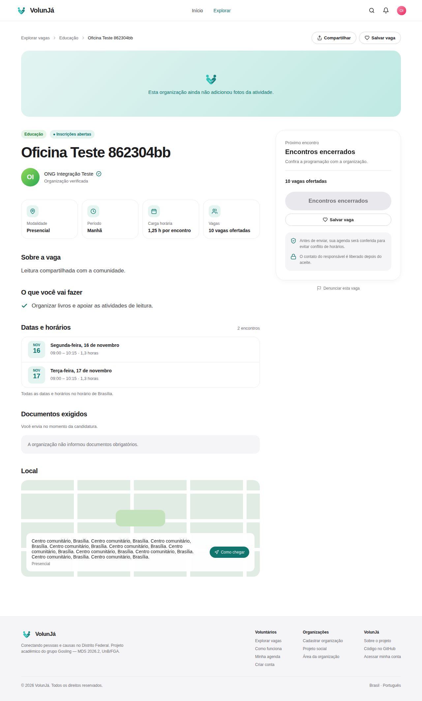{ loading=lazy width="1280" height="2120" }](../assets/testes/sistema-fe69315/vaga-publicada.png)

*Figura S17 — Vaga persistida e consultada após recarga. Fonte: [artefato da execução no GitHub Actions](https://github.com/FGA0138-MDS-Ajax/2026.2-T03-Gosling/actions/runs/44835433519/artifacts/14678950521), commit fe69315. Clique na imagem para ampliar.*

## Lacunas e próxima execução

Os 8 cenários acima não abrangem candidatura/documentos, triagem, calendário, conflito entre compromissos ou a coleta de usabilidade com pessoas. O [roteiro CT01–CT14](../testes.md#rastreabilidade-do-roteiro-ct01-a-ct14) distingue essas pendências. A listagem/edição institucional apresenta o [defeito DT01/DT02](../debitos-tecnicos.md#registro-de-tratamento).

As capturas atuais são evidências do commit fe69315 da branch de trabalho. A PR #88 foi encerrada sem merge na consulta de 20/11; integrar a implementação exige o fluxo de revisão do projeto. Para repetir a suíte, seguir [Como executar](../testes.md#como-executar-e-registrar) e registrar novo commit, ambiente, resultado e artefatos.
