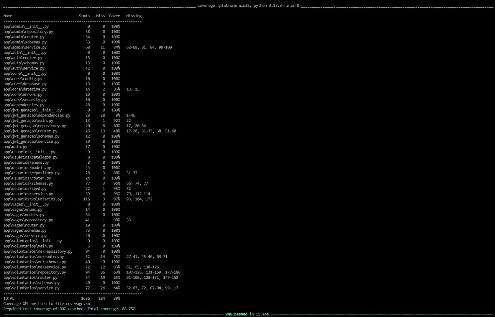
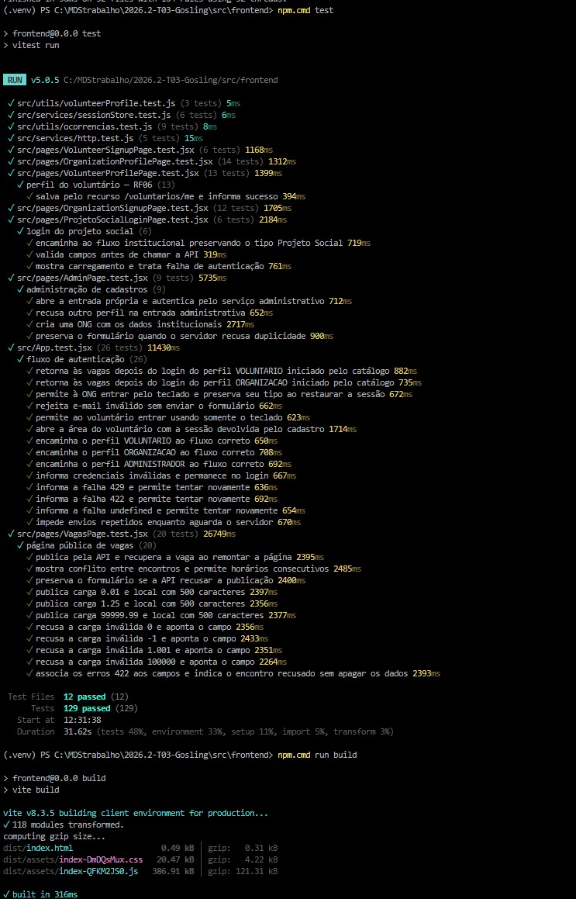
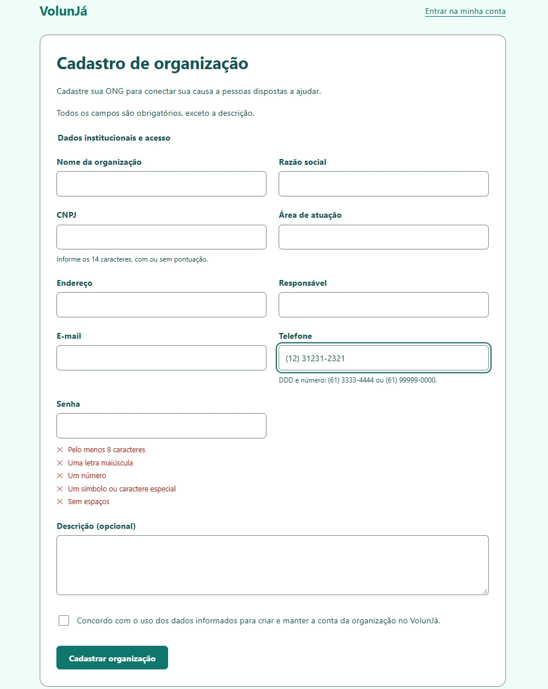
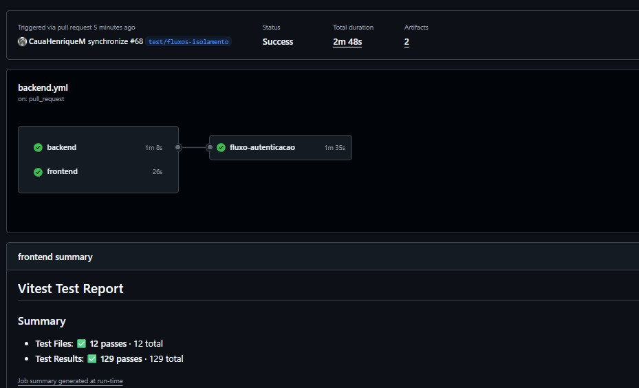
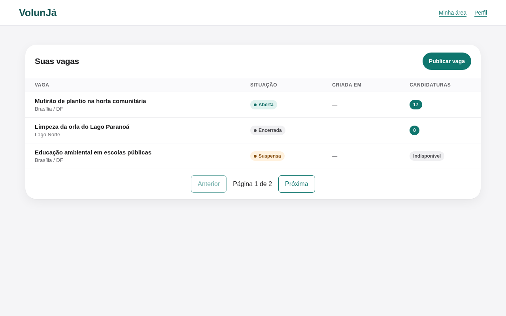
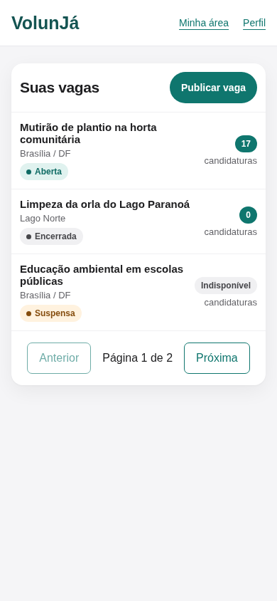
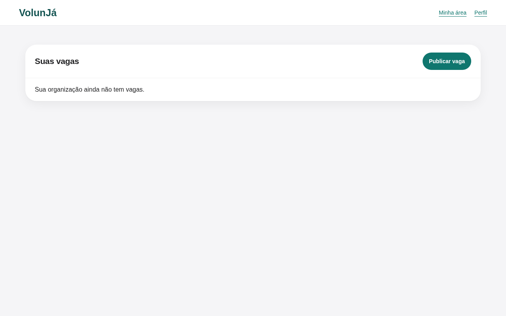
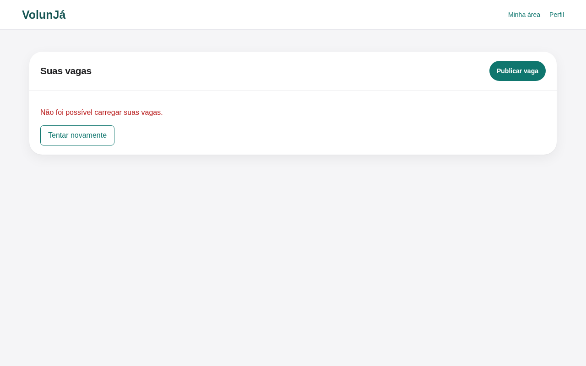
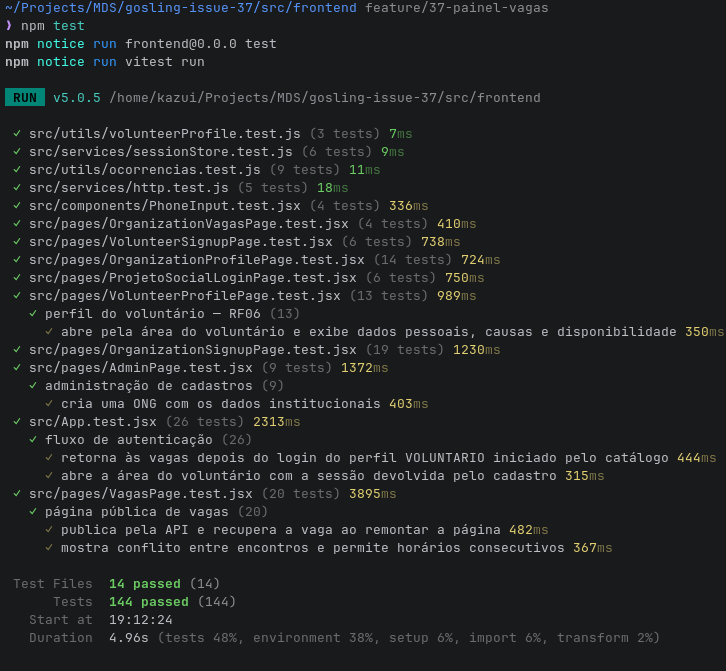

# Testes de publicação e gestão de vagas

**Entregas:** [PR #68](https://github.com/FGA0138-MDS-Ajax/2026.2-T03-Gosling/pull/68) e [PR #85](https://github.com/FGA0138-MDS-Ajax/2026.2-T03-Gosling/pull/85), com o histórico de RF09/RF10 nas [#84](https://github.com/FGA0138-MDS-Ajax/2026.2-T03-Gosling/pull/84) e [#93](https://github.com/FGA0138-MDS-Ajax/2026.2-T03-Gosling/pull/93). **Período:** Sprint 9 e acompanhamento na Sprint 10. **Roteiro:** CT02, CT03 e parte de CT14.

Publicação tem execução de sistema com persistência real. As capturas do painel da #85 usam sessão e API simuladas, conforme informado na própria PR. A edição/listagem institucional ainda tem um defeito de integração reproduzido com MySQL, registrado ao final desta página.

## Publicação — PR 68

| Caso | Resultado esperado | Resultado conhecido |
| --- | --- | --- |
| ONG autenticada | Publicar em nome da organização identificada pelo JWT. | Implementado na #68; fluxo real exercitado no E2E08. |
| Campos obrigatórios | Impedir envio inválido e apontar o campo que precisa de correção. | Ajustado após revisão; testes de componente/API e navegador. |
| Local com mais de 200 caracteres | Respeitar o limite de 500 caracteres do contrato. | Correção documentada na revisão da #68. |
| Carga horária decimal | Aceitar valores positivos com até duas casas decimais, como 0,01 e 1,25. | Validação e mensagens por campo registradas na entrega. |
| Múltiplos encontros | Persistir intervalos válidos, recusar sobreposição na própria vaga e exibir o horário de Brasília. | Testes de API e publicação no navegador. Conflito entre candidaturas permanece pendente. |
| Consulta pública | Manter a vaga após recarregar e disponibilizá-la ao visitante. | Verificado no teste de sistema E2E08. |

### Execuções e versões das evidências

As imagens anexadas durante a evolução da #68 têm contagens diferentes do texto final e do CI. Cada registro é apresentado com o seu escopo, sem tratar um print antigo como comprovação de uma execução posterior.

| Fonte | Backend | Frontend | Sistema |
| --- | --- | --- | --- |
| Prints originais da PR, figuras V1/V2 | **246 aprovados; 88,75% de cobertura** | **129 aprovados** | Não aparece nesse print do terminal. |
| Descrição final da PR | 283 aprovados; 88,90% de cobertura, informados como validação local | 140 aprovados | 7 aprovados, informados na PR. |
| [CI do commit final](https://github.com/FGA0138-MDS-Ajax/2026.2-T03-Gosling/actions/runs/43507230528) | **307 aprovados; 89,01% de cobertura** no job backend/MySQL | **140 aprovados** | Job de fluxo concluído com sucesso. |

[{ loading=lazy width="1600" height="1026" }](../assets/testes/pr-68-01.png)

*Figura V1 — Execução de backend anexada à #68 durante sua evolução. Fonte: [registro original](https://github.com/FGA0138-MDS-Ajax/2026.2-T03-Gosling/pull/68). Clique na imagem para ampliar.*

[{ loading=lazy width="743" height="1159" }](../assets/testes/pr-68-02.png)

*Figura V2 — Testes e build do frontend na execução mostrada no anexo. Fonte: [registro original](https://github.com/FGA0138-MDS-Ajax/2026.2-T03-Gosling/pull/68). Clique na imagem para ampliar.*

### Reparos decorrentes da revisão

A #68 registra que os comentários de Juan levaram a ajustes nos erros por campo, no tamanho do local e na carga horária decimal. A checklist da senha e a máscara do telefone também têm evidência visual. O cenário atual de publicação, com erros e encontros persistidos, está detalhado no [E2E08](sistema.md#e2e08-publicacao-validacoes-e-encontros).

[{ loading=lazy width="952" height="1196" }](../assets/testes/pr-68-04.png)

*Figura V3 — Validações da interface registradas na entrega integrada. Fonte: [registro original](https://github.com/FGA0138-MDS-Ajax/2026.2-T03-Gosling/pull/68). Clique na imagem para ampliar.*

[{ loading=lazy width="929" height="564" }](../assets/testes/pr-68-05.png)

*Figura V4 — Print do CI anexado à #68; o link da execução atual da PR está na tabela acima. Fonte: [registro original](https://github.com/FGA0138-MDS-Ajax/2026.2-T03-Gosling/pull/68). Clique na imagem para ampliar.*

## Painel da organização — PR 85

A #85 permanece **aberta**. As capturas a seguir foram produzidas com respostas da API simuladas, conforme a declaração da PR. Elas demonstram layout e estados da interface; a integração com o banco real não está aprovada por essas imagens.

| Cenário do painel | Esperado na interface | Evidência da entrega |
| --- | --- | --- |
| Organização com vagas | Exibir título, local, situação e contagem devolvida pelo serviço. | Desktop/mobile, figuras V5/V6. |
| Sem vagas | Exibir o estado vazio e orientar a publicação. | Figura V7. |
| Falha de carregamento | Exibir erro e permitir tentar novamente. | Figura V8. |
| Testes do frontend | Exercitar painel, proteção por perfil, paginação e estados. | Print da suíte com **144 aprovados**, figura V9. |

[{ loading=lazy width="1280" height="800" }](../assets/testes/pr-85-01.png)

*Figura V5 — Painel desktop, com API simulada. Fonte: [registro original](https://github.com/FGA0138-MDS-Ajax/2026.2-T03-Gosling/pull/85). Clique na imagem para ampliar.*

[{ loading=lazy width="390" height="844" }](../assets/testes/pr-85-03.png)

*Figura V6 — Layout mobile do painel, com API simulada. Fonte: [registro original](https://github.com/FGA0138-MDS-Ajax/2026.2-T03-Gosling/pull/85). Clique na imagem para ampliar.*

[{ loading=lazy width="1280" height="800" }](../assets/testes/pr-85-04.png)

*Figura V7 — Estado vazio validado na interface. Fonte: [registro original](https://github.com/FGA0138-MDS-Ajax/2026.2-T03-Gosling/pull/85). Clique na imagem para ampliar.*

[{ loading=lazy width="1280" height="800" }](../assets/testes/pr-85-05.png)

*Figura V8 — Tratamento de falha do serviço simulado. Fonte: [registro original](https://github.com/FGA0138-MDS-Ajax/2026.2-T03-Gosling/pull/85). Clique na imagem para ampliar.*

[{ loading=lazy width="726" height="671" }](../assets/testes/pr-85-06.png)

*Figura V9 — Resultado da suíte do frontend anexado à #85. Fonte: [registro original](https://github.com/FGA0138-MDS-Ajax/2026.2-T03-Gosling/pull/85). Clique na imagem para ampliar.*

## Defeito de integração de RF09 e RF10

Em 20/11, fora da suíte aprovada, foi criada uma vaga por POST com retorno 201 no sistema isolado com MySQL migrado. A listagem GET /organizacoes/me/vagas retornou 500; a alteração de estado e a alteração de horário por PUT /vagas/{id} também retornaram 500. Os logs registraram a coluna estado_vaga e a tabela candidaturas ausentes.

Essa reprodução continua registrada como [DT01/DT02](../debitos-tecnicos.md#registro-de-tratamento). O fechamento exige corrigir o contrato com o esquema real e executar listagem/edição usando banco migrado, incluindo propriedade e candidaturas. Testes com MagicMock e screenshots do painel simulado não encerram esse defeito.

## Evidências do fluxo completo

Veja [Testes de sistema — E2E08](sistema.md#e2e08-publicacao-validacoes-e-encontros) para o roteiro, resultado do CI e capturas reais do formulário, validações e vaga persistida.
