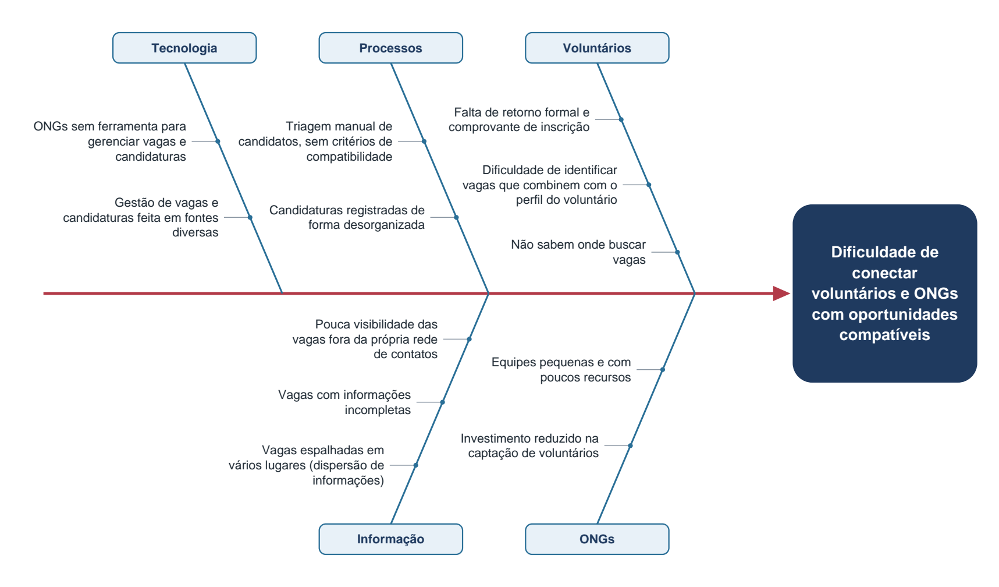
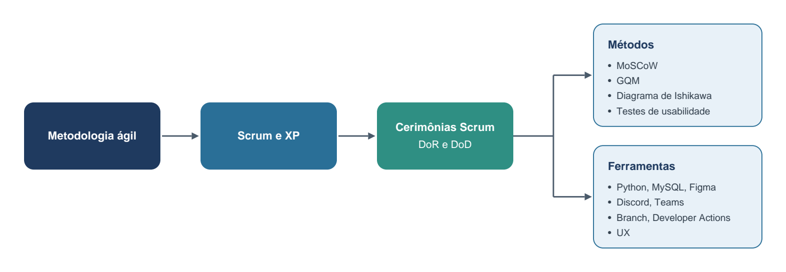
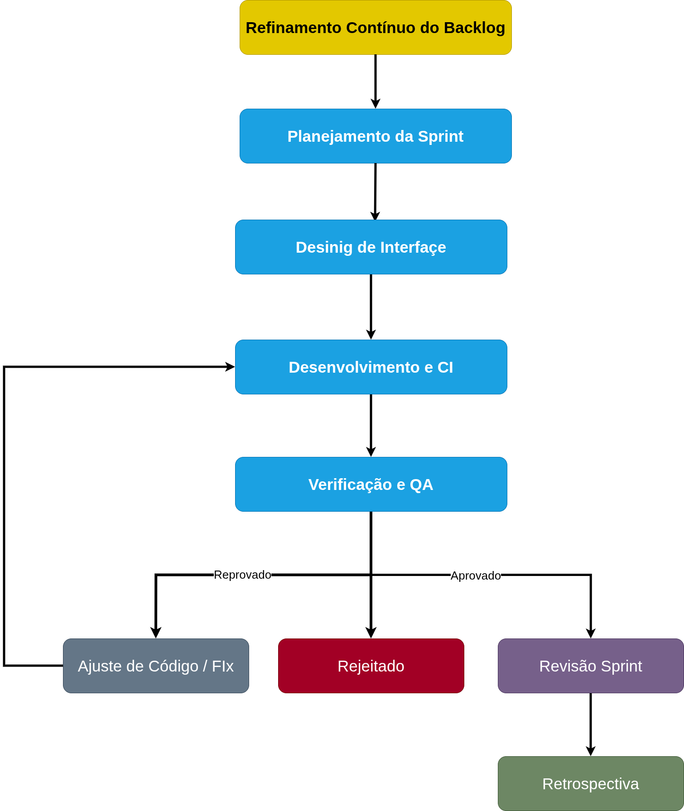

**Gosling - VolunJá**

# Visão do Produto e do Projeto

**Versão 0.4**

Arquivos originais: [PDF](documento%20de%20visao.pdf)

## Tabela 1 – Integrantes do Grupo

| **Mat.** | **Nome** | **Função (responsabilidade)** | **Pontos de participação na elaboração** |
|----|----|----|----|
| 231026661 | Cauã Henrique Moura Rodrigues | Dev Frontend/Backend | 25 |
| 232027529 | Juan Yuri Gabriel Brito Silva | Scrum Master | 25 |
| 232005432 | Miguel Tobias de Lima Galvão | Dev Frontend/Backend | 25 |
| 222026528 | Rafael Rodrigues Alencar | Dev Frontend/Backend | 25 |
| **Total de pontos** |  |  | **100** |

## Tabela 2 – Histórico de Revisões

| **Data** | **Versão** | **Descrição** | **Autor** |
|----|----|----|----|
| 17/09/2026 | 0.0 | Criação da estrutura inicial dos documentos de visão e arquitetura | Cauã Henrique Moura Rodrigues |
| 17/09/2026 | 0.1 | Estruturação do documento conforme template da disciplina; registro do problema, da declaração de posição do produto, dos objetivos, do escopo inicial e do backlog preliminar | Equipe Gosling |
| 21/09/2026 | 0.2 | Preenchimento completo do documento no template da disciplina (seções 1 a 7), com espaços reservados para as informações pendentes | Equipe Gosling |
| 30/09/2026 | 0.3 | Preenchimento dos campos de pesquisa bem como alinhamento de sprints definidas conforme o andamento do projeto | Equipe Gosling |
| 18/10/2026 | 0.4 | Inclusão do calendário do voluntário (RF26) e do bloqueio de conflitos de horário (RF27); detalhamento dos horários das vagas, regras de negócio e critérios de aceitação. | Equipe Gosling |

## 1 VISÃO GERAL DO PRODUTO

### 1.1 Problema

#### 1.1.1 Contexto de negócio

O trabalho voluntário é um dos principais insumos do terceiro setor brasileiro. Organizações Não Governamentais (ONGs), associações e projetos sociais atrelados a essas organizações dependem de pessoas dispostas a doar tempo e competências para executar suas atividades-fim - acolhimento, educação, saúde, assistência, cultura, meio ambiente e defesa de direitos. Do outro lado, existe um contingente de pessoas interessadas em atuar como voluntárias, mas que não sabe onde procurar oportunidades.

Hoje, a divulgação de vagas de voluntariado é **descentralizada e informal**: acontece em perfis de redes sociais, grupos de mensagens, cartazes, sites próprios de cada organização e pelo boca a boca. Assim, a oferta (vagas das ONGs) e a demanda (pessoas dispostas a se voluntariar) não se encontram de forma sistemática e, quando se encontram, frequentemente há incompatibilidade de **interesse, disponibilidade de horário, localização e tipo de atividade**. O Quadro 1 sintetiza o tema, o problema e a questão-problema que orientam este documento.

**Quadro 1 –** Síntese do tema, problema e questão-problema

| **Item** | **Descrição** |
|----|----|
| **Tema** | Desenvolvimento de uma plataforma de voluntariado para conectar voluntários e ONGs, com foco em UX. |
| **Problema** | Pessoas interessadas em realizar trabalho voluntário e organizações que necessitam de voluntários têm dificuldade para se encontrar e identificar oportunidades compatíveis quanto a interesse, disponibilidade, localização e necessidades das atividades. |
| **Questão-problema** | Como facilitar o encontro entre pessoas interessadas em trabalho voluntário e organizações que necessitam de voluntários, considerando suas necessidades e disponibilidades? |

#### 1.1.2 Problema encontrado

Atualmente as ONGs e os trabalhadores voluntários têm dificuldade de centralizar suas publicações de vagas, bem como dificuldade de saber onde buscar todas as vagas de trabalho voluntário disponíveis. O problema tem duas perspectivas:

- **ONG:** pouca visibilidade das vagas fora da própria rede de contatos, triagem manual de candidatos e ausência de registro organizado das candidaturas (IBGE, 2018).

- **Voluntário:** Dificuldade de descobrir e utilizar canais de busca (IBGE, 2018).

**Figura 1 –** Diagrama de Ishikawa do problema

A Figura 1 tem como efeito o fato de que **voluntários e ONGs não se encontram de forma eficiente**, com causas agrupadas em cinco categorias interligadas. A dispersão da **informação** torna o **processo** de triagem manual e caro para a ONG; esse custo faz com que organizações com equipes pequenas (**pessoas**) invistam pouco em captação, o que realimenta a baixa visibilidade. Já a ausência de um canal digital adequado (**tecnologia**) impede que critérios de **compatibilidade** (turno, carga horária, modalidade e localização) sejam aplicados antes do contato humano.

#### 1.1.3 Solução de software proposta

Propõe-se uma **aplicação web** que centraliza a publicação e a busca de vagas de voluntariado, atuando como ponte entre ONGs e voluntários. A solução ataca as causas da Figura 1 em quatro frentes: reúne as vagas em um catálogo único com campos padronizados (*informação*); transforma esses campos em filtros de busca (*compatibilidade*); estrutura a candidatura, do envio de documentos ao comprovante e ao contato com o responsável (*processo*); e oferece às ONGs um canal de divulgação sem exigir infraestrutura própria (*tecnologia*).

A solução também oferece um calendário pessoal com as vagas em que o voluntário possui candidatura ativa e os horários de cada dia (RF26). Antes de registrar uma nova candidatura, verifica a agenda e impede sobreposição com outra vaga, identificando o conflito para o usuário (RF27).

O **foco em UX** faz parte da solução: como o público é heterogêneo em idade e familiaridade digital, uma interface confusa reproduziria dentro do sistema a mesma barreira que existe fora dele. Por isso, usabilidade e acessibilidade são requisitos do backlog (seção 4.4) e são medidas conforme a seção 5.1.

### 1.2 Declaração de Posição do Produto

O Quadro 2 apresenta a declaração de posição do produto no formato proposto pela disciplina.

**Quadro 2 –** Declaração de posição do produto

| **Para:** | Pessoas interessadas em realizar trabalho voluntário e organizações do terceiro setor (ONGs e associações) que necessitam de voluntários. |
|----|----|
| **Necessidade:** | Encontrar, de forma centralizada e confiável, oportunidades de voluntariado e voluntários compatíveis quanto a interesse, disponibilidade, localização e necessidades da atividade. |
| **O VolunJá** | É uma aplicação web de conexão entre voluntários e organizações do terceiro setor. |
| **Que:** | Reúne em um só lugar as vagas de voluntariado, permite buscá-las por filtros que refletem a disponibilidade real do voluntário e conduz a candidatura até o contato com o responsável pela vaga, com emissão de comprovante. |
| **Ao contrário:** | Da divulgação dispersa em redes sociais, grupos de mensagens e sites de cada organização. Sem o produto, a conexão continua dependendo do acaso: a ONG não preenche suas vagas e o voluntário desiste por não encontrar uma oportunidade compatível. |
| **Nosso produto:** | Estrutura a busca sobre os mesmos campos que a ONG preenche ao publicar a vaga e tem a interface projetada e avaliada com foco em UX, para ser utilizável por pessoas com diferentes níveis de familiaridade digital. |

O diferencial declarado no Quadro 2 se apoia em dois pontos: a padronização dos campos da vaga, que viabiliza a busca por compatibilidade, e o cuidado com a experiência de uso.

#### 1.2.1 Usuários-alvo e clientes

**Quadro 3 –** Usuários-alvo e clientes do produto

| **Usuário-alvo** | **Características** | **Por que o produto é importante para ele** |
|----|----|----|
| **Voluntário** | Pessoa física interessada em doar tempo a causas sociais; possui disponibilidade limitada e específica (turnos, dias, carga horária); perfil heterogêneo em idade, formação e familiaridade digital - de estudantes a aposentados. | Passa a ter um ponto único de busca, com filtros que respeitam sua agenda e sua localização, além de um registro formal da candidatura e um comprovante da atividade. |
| **ONG / Organização** | Organização do terceiro setor, frequentemente com equipe reduzida e sem área dedicada à captação de voluntários; possui demandas recorrentes e sazonais por mão de obra voluntária. | Ganha visibilidade para suas vagas além da própria rede de contatos e recebe candidaturas já organizadas segundo os critérios que ela mesma definiu, reduzindo o esforço de triagem. |
| **Cliente / P.O.** | Professor da disciplina, que acompanha o histórico de commits e o desenvolvimento do projeto; tem como ponto de contato com a equipe o monitor responsável pelo grupo Gosling. | Avalia se o produto atende aos seus usuários-alvo e se cumpre os requisitos previamente delimitados pelo escopo do problema, sendo quem valida e homologa as entregas da equipe. |

Como mostra o Quadro 3, voluntários e ONGs são os usuários diretos e representam as duas pontas da conexão; o cliente valida se a solução atende ao escopo.

#### 1.2.2 Alternativas competitivas

O Quadro 4 compara o produto às plataformas já existentes que conectam pessoas a oportunidades de trabalho, voluntário ou não.

**Quadro 4 –** Análise de alternativas competitivas

| **Plataforma** | **O que oferece** | **Limitações para o problema** | **Diferencial do nosso produto** |
|----|----|----|----|
| **LinkedIn** | Oferta de trabalhos remunerados e posts como mídias sociais | Dificuldade de ONGs se cadastrarem e manterem trabalhos não remunerados pois não são destacados na plataforma | Nosso produto será destinado especificamente para trabalhos voluntários sem fins lucrativos, mantendo um pé de igualdade na visibilidade das vagas |
| **InfoJobs** | Oferta de trabalhos remunerados | Dificuldade de ONGs se cadastrarem e manterem trabalhos não remunerados pois não são destacados na plataforma pois não possuem valores significativos de bonificação | Nosso produto será destinado especificamente para trabalhos voluntários sem fins lucrativos, mantendo um pé de igualdade na visibilidade das vagas |
| **Atados** | Oferta de trabalhos voluntários | Não há uma credibilidade por perfil de voluntários ou FAQ das ONGs | Nosso produto terá a possibilidade de dar credibilidade aos voluntários, aumentando o engajamento por procura de vagas para aumentar o ranking pessoal. Além de possibilitar os comentários de determinadas ONGs em seus perfis. |

### 1.3 Objetivos do Produto

**Objetivo geral:** desenvolver uma aplicação web que facilite o encontro entre pessoas interessadas em trabalho voluntário e organizações que necessitam de voluntários, considerando as necessidades e as disponibilidades de ambas as partes.

**Objetivos específicos:**

1.  Permitir que organizações se cadastrem e publiquem vagas com informações padronizadas.

<!-- -->

1.  Permitir que voluntários se cadastrem e mantenham um perfil com seus interesses e sua disponibilidade.

2.  Oferecer busca de vagas por filtros de causa, modalidade, local, carga horária e período.

3.  Estruturar a candidatura, com envio de documentação e emissão de comprovante.

4.  Conectar o responsável pela vaga na ONG ao voluntário candidato.

5.  Entregar uma interface acessível e fácil de usar para pessoas com diferentes níveis de familiaridade digital.

7. Permitir que o voluntário consulte sua agenda de vagas e impedir candidaturas com horários sobrepostos (RF26 e RF27).

Os objetivos 1 a 3 respondem às causas de informação e compatibilidade; os objetivos 4 e 5, ao processo manual de candidatura; o objetivo 6, ao foco em UX; e o objetivo 7, à organização dos compromissos e à prevenção de conflitos de horário.

### 1.4 Tecnologias a Serem Utilizadas

**Quadro 5 –** Tecnologias, ferramentas e métodos adotados

| **Categoria** | **Tecnologia / Ferramenta** | **Situação** |
|----|----|----|
| Versionamento | Git e GitHub | Definido |
| Documentação | MkDocs (tema Material), publicado no GitHub Pages via GitHub Actions | Definido |
| Política de branches | main (produção) e developer (desenvolvimento) | A definir |
| *Front-end* | Javascript, utilizando React | A definir |
| *Back-end* | Python | A definir |
| Banco de dados | MySQL | A definir |
| Prototipação de interface | Figma | A definir |
| Gestão do backlog e comunicação | Discord e Teams. Backlog registrados via md Branch developer | A definir |
| Testes | Partes de automação no actions e partes de UX. | A definir |
| Métodos e técnicas | Scrum e XP (seção 3); MoSCoW (seção 4.1); GQM (seção 5.1); Ishikawa (seção 1.1) | Definido |

O Quadro 5 registra quais tecnologias serão adotadas; o detalhamento de como elas se articulam é objeto do Documento de Arquitetura.

## 2 VISÃO GERAL DO PROJETO

### 2.1 Ciclo de vida do projeto de desenvolvimento de software

O projeto adota um **ciclo de vida iterativo e incremental**, em sprints de 7 dias, de quarta a terça-feira. A Figura 2 instancia esse ciclo conforme o modelo apresentado na disciplina.

**Figura 2 –** Ciclo de vida adotado no projeto

- **Metodologia:** ágil, baseada em Scrum e XP.

- **Processo:** sprints com planejamento, desenvolvimento, revisão e retrospectiva (seção 3).

- **Procedimentos:** cerimônias do Scrum, conceito de preparado (DoR) e conceito de pronto (DoD).

- **Métodos:** MoSCoW, GQM, diagrama de Ishikawa e testes de usabilidade.

- **Ferramentas:** as listadas no Quadro 5.

A escolha se justifica pelo contexto: um projeto acadêmico de um semestre, com equipe de quatro pessoas, prazo fixo e requisitos que ainda dependem de pesquisa com usuários. Iterações curtas permitem validar a interface com usuários a cada incremento, o que é indispensável para o foco em UX, e antecipam a detecção de problemas de escopo e de inexperiência com as tecnologias (riscos R2 e R3 do Quadro 8).

### 2.2 Organização do Projeto

O Quadro 6 distribui os papéis do projeto, sem relação de hierarquia entre eles; um mesmo integrante pode acumular papéis.

**Quadro 6 –** Papéis e responsabilidades

| **Papel** | **Atribuições** | **Responsável** | **Participantes** |
|----|----|----|----|
| **Desenvolvedor** | Codificar o produto e os testes unitários, refatorar e revisar código. | Grupo | Cauã, Juan, Miguel, Rafael |
| **Dono do Produto (P.O.)** | Manter e priorizar o backlog, organizar o escopo das sprints e validar as entregas. | Professor e Monitores | Ajax, Sophia |
| **Scrum Master** | Facilitar as cerimônias e remover impedimentos. | Líder do Grupo | Juan |
| **Analista de Qualidade** | Garantir o conceito de pronto, inspecionar o código e revisar os testes. | Grupo | Cauã, Juan, Miguel, Rafael |
| **Designer / UX** | Elaborar protótipos e conduzir os testes de usabilidade. | Grupo | Cauã, Juan, Miguel, Rafael |
| **Cliente** | Validar requisitos, participar das revisões e homologar as entregas. | Professor da disciplina | Monitor responsável pelo grupo Gosling |

### 2.3 Planejamento das Fases e/ou Iterações do Projeto

O projeto é organizado em 11 sprints de 7 dias, de quarta a terça-feira, alinhadas ao cronograma da disciplina. As Sprints 1 a 5 cobrem a documentação: entrega do Documento de Visão em 30/09 e do Documento de Arquitetura em 07/10, com apresentações em 14/10 e 19/10. As Sprints 6 a 11 cobrem o desenvolvimento, do kick-off em 26/10 à apresentação do software em funcionamento. A Tabela 3 é atualizada ao final de cada sprint, com o percentual de conclusão em intervalos mínimos de 10%.

**Tabela 3 –** Planejamento das sprints

| **Sprint** | **Produto (Entrega)** | **Data início** | **Data fim** | **Entregável(eis)** | **Responsáveis** | **% conclusão** |
|----|----|----|----|----|----|----|
| Sprint 1 | Definição do produto | 16/09/2026 | 22/09/2026 | DV (versão inicial) e Ishikawa | Grupo |  |
| Sprint 2 | Conclusão do Documento de Visão | 23/09/2026 | 29/09/2026 | DV (entrega em 30/09) e BLP | Grupo |  |
| Sprint 3 | Documento de Arquitetura | 30/09/2026 | 06/10/2026 | DA (entrega em 07/10) | Grupo |  |
| Sprint 4 | Protótipo e apresentação do DV | 07/10/2026 | 13/10/2026 | PROTO; apresentação do DV (14/10) | Grupo |  |
| Sprint 5 | Apresentação do DA e preparação do ambiente | 14/10/2026 | 20/10/2026 | Apresentação do DA (19/10); ambiente configurado | Grupo |  |
| Sprint 6 | Kick-off do desenvolvimento: cadastro e autenticação (CN01) | 21/10/2026 | 27/10/2026 | Incremento e RT | Grupo |  |
| Sprint 7 | Perfis de voluntário e de organização (CN02 e CN03) | 28/10/2026 | 03/11/2026 | Incremento e RT | Grupo |  |
| Sprint 8 | Publicação e gestão de vagas (CN04) | 04/11/2026 | 10/11/2026 | Incremento e RT; ponto de controle (09/11 ou 11/11) | Grupo |  |
| Sprint 9 | Busca, candidatura e calendário (CN05, CN06 e CN10) | 11/11/2026 | 17/11/2026 | Incremento e RT; inspeção (16/11) | Grupo |  |
| Sprint 10 | Triagem, conexão e comprovante (CN07 e CN08); correção dos defeitos da inspeção | 18/11/2026 | 24/11/2026 | Incremento e RT | Grupo |  |
| Sprint 11 | Ajustes de UX e entrega final | 25/11/2026 | 01/12/2026 | Incremento e RU; apresentação do software (30/11 ou 02/12) | Grupo |  |

Legenda: DV = Documento de Visão; DA = Documento de Arquitetura; BLP = backlog do produto; PROTO = protótipo de interface; RT = relatório de testes; RU = relatório de usabilidade; CN = cenário (Tabela 5).

### 2.4 Matriz de Comunicação

O Quadro 7 apresenta a estratégia de comunicação usada para acompanhar o progresso do projeto.

**Quadro 7 –** Matriz de comunicação

| **Descrição** | **Área / Envolvidos** | **Periodicidade** | **Produtos gerados** |
|----|----|----|----|
| Acompanhamento das atividades, dos riscos e das pendências | Equipe do projeto | Semanal | Ata de reunião; relatório de situação |
| Planejamento da sprint | Equipe e P.O. | Início de cada sprint | Backlog da sprint |
| Revisão e retrospectiva da sprint | Equipe, P.O. e cliente | Fim de cada sprint | Incremento validado; ações de melhoria |
| Comunicação da situação do projeto | Equipe, professor e monitor | Semanal | Ata de reunião; relatório de situação |

Canais utilizados: Discord.

### 2.5 Gerenciamento de Riscos

Os riscos são identificados, classificados pelo grau de exposição (probabilidade × impacto) e revisados a cada sprint, na retrospectiva. Para cada risco há um plano de mitigação, que busca evitá-lo, e um de contingência, aplicado caso ele ocorra, conforme o Quadro 8.

**Quadro 8 –** Riscos do projeto

| **Risco** | **Exposição** | **Mitigação** | **Contingência** |
|----|----|----|----|
| **R1** - Afastamento ou desistência de um integrante | Alta | Código coletivo, documentação atualizada e programação em par. | Redistribuir tarefas e renegociar o escopo da sprint. |
| **R2** - Inexperiência com as tecnologias escolhidas | Alta | Escolher tecnologias conhecidas pela equipe e reservar tempo de estudo na Sprint 5. | Simplificar a solução técnica e adiar requisitos Could. |
| **R3** - Escopo grande demais para o semestre | Alta | Priorizar com MoSCoW e fechar o MVP apenas com requisitos Must. | Acionar o replanejamento (seção 2.6) e cortar requisitos Should e Could. |
| **R4** - Conflito de agenda entre os integrantes | Média | Fixar horários de reunião e registrar a comunicação assíncrona. | Ajustar a carga da sprint à disponibilidade real. |
| **R5** - Indisponibilidade do cliente para validar entregas | Média | Agendar validações com antecedência e registrar requisitos por escrito. | P.O. valida provisoriamente, com homologação posterior em ata. |
| **R6** - Interface não atender ao foco em UX | Alta | Prototipar antes de codificar e testar a usabilidade a cada incremento. | Usar a Sprint 11 para corrigir os problemas encontrados. |
| **R7** - Requisitos baseados em hipóteses, sem contato direto com ONGs e voluntários | Alta | Basear os requisitos em dados públicos e em vagas reais; testar o protótipo com potenciais voluntários a cada incremento. | Revisar o backlog e reprogramar as funcionalidades cujas hipóteses não se confirmarem. |

### 2.6 Critérios de Replanejamento

O projeto é replanejado quando:

- menos de 70% dos itens comprometidos na sprint são concluídos;

- um risco de exposição alta do Quadro 8 se concretiza;

- a capacidade da equipe diminui, por afastamento ou indisponibilidade de integrantes;

- um requisito Must é incluído, alterado ou removido pelo cliente;

- uma entrega é rejeitada na revisão da sprint ou reprovada em teste de usabilidade.

Todo replanejamento gera uma nova versão deste documento, registrada na Tabela 2.

## 3 PROCESSO DE DESENVOLVIMENTO DE SOFTWARE

O processo segue o **Scrum**, com os papéis do Quadro 6, e incorpora práticas do **XP**. Ele é um guia para a equipe, não uma regra rígida, e instancia o ciclo de vida da seção 2.1. A Figura 3 ilustra o fluxo de trabalho.

**Figura 3 –** Fluxo de trabalho do processo de desenvolvimento

### 3.1 Scrum adaptado

Cada sprint percorre as atividades abaixo, cada uma com um responsável:

1.  **Refinamento do backlog** (P.O., contínuo): detalhar e priorizar os itens.

<!-- -->

1.  **Planejamento da sprint** (equipe e P.O.): selecionar os itens e dividi-los em tarefas.

<!-- -->

1.  **Design de interface** (Designer/UX): prototipar os itens antes de codificar.

<!-- -->

1.  **Desenvolvimento** (Desenvolvedores): codificar e testar, com integração contínua.

<!-- -->

1.  **Verificação** (Analista de Qualidade): executar o roteiro de testes e revisar o código.

<!-- -->

1.  **Revisão da sprint** (equipe, P.O. e cliente): apresentar e validar o incremento.

<!-- -->

1.  **Retrospectiva** (Scrum Master): avaliar o processo e atualizar riscos e métricas.

### 3.2 Práticas do XP adotadas

- **Programação em par** nas tarefas mais complexas, disseminando conhecimento (riscos R1 e R2).

- **Código coletivo**: qualquer integrante pode alterar qualquer parte do código, mediante revisão.

- **Integração contínua** na branch developer, com *pull requests* revisados antes do *merge*.

- **Refatoração** contínua, sem alterar o comportamento do sistema.

- **Testes automatizados** escritos junto com cada funcionalidade.

- **Ritmo sustentável**: a carga de cada sprint é dimensionada pela velocidade medida.

### 3.3 Conceito de preparado e conceito de pronto

**Preparado (DoR):** o item só entra na sprint se tiver critérios de aceitação claros, prioridade MoSCoW definida e cenário associado (Tabela 5).

**Pronto (DoD):** o item só é concluído quando está integrado à branch developer por *pull request* revisado, tem testes automatizados passando, atende aos critérios de aceitação e passou pelo roteiro de testes da seção 6.2.

## 4 DECLARAÇÃO DE ESCOPO DO PROJETO

O escopo do produto corresponde a uma **aplicação web** na qual será possível:

- realizar o **cadastro de uma ONG**, que poderá cadastrar vagas de trabalho voluntário com as informações: vaga, descrição da vaga, descrição das atividades, área de atuação/causa, modalidade (presencial, remoto ou híbrido), local, carga horária, período (manhã, tarde, noite ou madrugada) e número de vagas;

- realizar o **cadastro de voluntários**, que poderão buscar vagas dentro de seus interesses, a partir de filtros sobre as informações básicas de uma vaga;

- realizar a **candidatura à vaga**, encaminhando a documentação necessária e recebendo um comprovante;

- realizar a **ponte de conexão** entre o responsável pela vaga na ONG e o voluntário, para as demais tratativas.

O escopo inclui o calendário do voluntário e o bloqueio de candidaturas incompatíveis com seus compromissos na plataforma. Cada vaga deve informar datas e horários exatos de início e fim de todas as ocorrências; o período do dia e a carga horária permanecem como informações de busca.

### 4.1 Backlog do produto

O backlog é organizado por perfis (seção 4.2) e cenários (seção 4.3) e detalhado na Tabela 6 (seção 4.4). A priorização usa a técnica MoSCoW, com o seguinte significado para este produto, a ser validado pelo P.O.:

- **Must:** sem o requisito, o produto não responde à questão-problema do Quadro 1; compõe o MVP.

- **Should:** aumenta o valor entregue, mas sua ausência não impede o fluxo principal.

- **Could:** agrega conveniência; só é feito se sobrar capacidade e é o primeiro a sair no replanejamento.

Como a equipe não tem acesso direto a ONGs e voluntários para aplicar questionários ou entrevistas, os requisitos foram elicitados a partir de fontes indiretas, conforme o Quadro 9, e são tratados como hipóteses, validadas de forma incremental nos testes de usabilidade com o protótipo e nas revisões com o P.O.

**Quadro 9 –** Técnicas de elicitação utilizadas

| **Fonte** | **Técnica de elicitação** | **Justificativa** |
|----|----|----|
| **Voluntário** | Análise documental (dados públicos) e personas | Caracteriza o perfil e a disponibilidade do voluntário sem contato direto; as personas representam esse público nas decisões de interface. |
| **ONG / Organização** | Análise de conteúdo de vagas publicadas | As vagas já divulgadas mostram quais informações as organizações usam e o que costuma faltar, base dos campos padronizados (RF07). |
| **Equipe** | *Brainstorming* e análise de concorrentes | Base do diagrama de Ishikawa (Figura 1) e do Quadro 4. |
| **Usuários representativos** | Prototipação e teste de usabilidade | Valida as hipóteses de interface com potenciais voluntários (colegas e pessoas próximas), conforme a métrica M6. |
| **Cliente / P.O.** | Reuniões de validação | Confirmam as prioridades e o escopo de cada sprint. |

Foram analisadas 5 vagas de voluntariado publicadas nas plataformas <https://www.linkedin.com>; <https://voluntariadoemacao.sejus.df.gov.br/>, entre 17/09/2026 e 30/09/2026.

### 4.2 Perfis

A Tabela 4 apresenta os perfis de acesso do sistema e suas permissões.

**Tabela 4 –** Perfis de acesso

| **\#** | **Nome do perfil** | **Características do perfil** | **Permissões de acesso** |
|----|----|----|----|
| 1 | **Visitante** | Usuário não autenticado. | Ver e buscar vagas; cadastrar-se como voluntário ou organização. |
| 2 | **Voluntário** | Pessoa física autenticada. | Permissões do Visitante; manter o próprio perfil; candidatar-se e enviar documentos; acompanhar candidaturas; emitir comprovante; ver o contato do responsável após o aceite. |
| 3 | **ONG / Organização / Responsável por Projetos Sociais** | Organização autenticada que publica vagas. | Manter o perfil da organização; criar, editar e encerrar vagas; triar, aceitar ou recusar candidaturas; ver o contato dos voluntários aceitos. |
| 4 | **Administrador** | Mantém os perfis de acesso da aplicação. | Manter usuários; homologar organizações; moderar vagas irregulares. |

Os perfis 2 e 3 são exclusivos em uma mesma conta, pois têm fluxos e telas distintos.

### 4.3 Cenários

A Tabela 5 agrupa as funcionalidades em cenários e indica a sprint prevista para cada um.

**Tabela 5 –** Cenários funcionais

**Sistema: VolunJá - Cenários funcionais**

| **Numeração do cenário** | **Nome do cenário** | **Sprints** |
|----|----|----|
| CN01 | Cadastro e autenticação de usuários | Sprint 6 |
| CN02 | Gestão do perfil do voluntário | Sprint 7 |
| CN03 | Gestão do perfil da organização | Sprint 7 |
| CN04 | Publicação e gestão de vagas pela ONG | Sprint 8 |
| CN05 | Busca e visualização de vagas | Sprint 9 |
| CN06 | Candidatura do voluntário à vaga com validação de horários | Sprint 9 |
| CN07 | Triagem de candidaturas e conexão entre ONG e voluntário | Sprint 10 |
| CN08 | Comprovação da atividade voluntária | Sprint 10 |
| CN09 | Administração e moderação da plataforma | Sprints 9 a 11 |
| CN10 | Consulta do calendário do voluntário | Sprint 9 |

### 4.4 Tabela de Backlog do produto

Os requisitos **Must** formam o MVP e cobrem o caminho completo da questão-problema: a ONG publica a vaga (RF08), o voluntário a encontra por filtros (RF13), candidata-se com documentos e sem conflito de horário (RF16, RF17 e RF27), consulta seu calendário (RF26), é triado (RF19), recebe o comprovante (RF22) e é conectado ao responsável (RF21). As *user stories* seguem o formato "Eu, como &lt;perfil&gt;, quero &lt;ação&gt;, para &lt;benefício&gt;" e ficam registradas no backlog em markdown.

**US26:** Eu, como voluntário, quero visualizar em um calendário as vagas em que estou inscrito e os horários de cada dia, para organizar meus compromissos de voluntariado.

**US27:** Eu, como voluntário, quero ser avisado e impedido de me candidatar a uma vaga com horário conflitante, para não assumir compromissos simultâneos.

**RN01 — Agenda ativa:** candidaturas PENDENTES e ACEITAS ocupam os horários de todas as ocorrências da vaga. RECUSADAS e CANCELADAS não ocupam a agenda. Encerrar o recebimento de candidaturas de uma vaga não cancela os compromissos já assumidos.

**RN02 — Sobreposição:** há conflito quando início_novo < fim_existente e fim_novo > início_existente. Horários consecutivos, como 09h–10h e 10h–11h, são permitidos. Basta uma ocorrência em conflito para impedir a candidatura inteira. Datas diferentes só conflitam quando os intervalos efetivamente se cruzam, inclusive ao atravessar a meia-noite.

**RN03 — Datas e horários:** toda ocorrência deve ter início anterior ao fim, com exibição no horário de Brasília. No MVP, a ONG cadastra explicitamente cada ocorrência; regras automáticas de recorrência e integração com calendários externos ficam fora do escopo.

**RN04 — Bloqueio e retorno:** a verificação ocorre no servidor antes do registro. Havendo conflito, não são criados candidatura, comprovante ou notificação de sucesso. A interface informa nome da vaga conflitante, data, início e fim, e oferece acesso ao calendário.

**RN05 — Consistência:** no MVP, a edição dos horários de uma vaga é bloqueada enquanto existir candidatura PENDENTE ou ACEITA. O calendário reflete imediatamente o registro, a recusa ou o cancelamento de uma candidatura após a confirmação do servidor.

**Tabela 6 –** Backlog do produto

**Sistema: VolunJá - Backlog do produto**

| **Numeração (cenário / requisito)** | **Sprint** | **Nome do requisito** | **Tipo de requisito (funcional / não funcional)** | **Priorização (Must, Should, Could)** | **Descrição sucinta do requisito** | ***User stories* (U.S.) associadas** |
|----|----|----|----|----|----|----|
| CN01-RF01 | 6 | Cadastro de voluntário | Funcional | Must | Criar conta de pessoa física com nome, e-mail, senha, CPF, localização e contato. | US01 |
| CN01-RF02 | 6 | Cadastro de organização | Funcional | Must | Criar conta de ONG com razão social, CNPJ, área de atuação, endereço e responsável. | US02 |
| CN01-RF03 | 6 | Cadastro de Projeto Social | Funcional | Could | Criar conta de um responsável por um projeto social. Com campos de nome, CPF, e-mail, localização, área de atuação, causa e endereço responsável | US03 |
| CN01-RF04 | 6 | Autenticação de usuários | Funcional | Must | Entrar e sair com e-mail e senha, direcionando o usuário conforme seu perfil. | US04 |
| CN01-RF05 | A definir | Recuperação de senha | Funcional | Should | Redefinir a senha por link enviado ao e-mail cadastrado. | US05 |
| CN02-RF06 | 7 | Manter perfil do voluntário | Funcional | Must | Editar dados pessoais, áreas de interesse e disponibilidade (dias, período e carga horária). | US06 |
| CN03-RF07 | 7 | Manter perfil da organização | Funcional | Must | Editar os dados institucionais, a descrição da ONG e os canais de contato. | US07 |
| CN04-RF08 | 8 | Cadastrar vaga de voluntariado | Funcional | Must | Publicar vaga com descrição, atividades, causa, modalidade, local, carga horária, período, nº de vagas e uma ou mais ocorrências com data/hora de início e fim. | US08 |
| CN04-RF09 | 8 | Editar e encerrar vaga | Funcional | Must | Alterar os dados da vaga e encerrá-la. No MVP, impedir alteração dos horários enquanto houver candidaturas PENDENTES ou ACEITAS. | US09 |
| CN04-RF10 | 8 | Listar vagas da organização | Funcional | Must | Painel da ONG com suas vagas, a situação de cada uma e o número de candidaturas. | US10 |
| CN04-RF11 | A definir | Definir documentação exigida | Funcional | Should | Indicar os documentos que o voluntário deve enviar ao se candidatar. | US11 |
| CN05-RF12 | A definir | Listar vagas disponíveis | Funcional | Must | Listar publicamente as vagas abertas, com suas informações essenciais. | US12 |
| CN05-RF13 | A definir | Buscar vagas por filtros | Funcional | Must | Filtrar vagas por área de atuação/causa, modalidade, local, carga horária e período. | US13 |
| CN05-RF14 | 9 | Visualizar detalhes da vaga | Funcional | Must | Exibir a página completa da vaga, a organização e todas as datas e horários de início e fim das atividades. | US14 |
| CN05-RF15 | A definir | Recomendar vagas compatíveis | Funcional | Could | Sugerir vagas compatíveis com os interesses e a disponibilidade do voluntário. | US15 |
| CN06-RF16 | 9 | Candidatar-se a uma vaga | Funcional | Must | Registrar a candidatura somente após validar ausência de conflito de horário com as candidaturas ativas do voluntário (RF27). | US16 |
| CN06-RF17 | A definir | Enviar documentação da candidatura | Funcional | Must | Enviar os documentos exigidos pela organização no ato da candidatura. | US17 |
| CN06-RF18 | A definir | Acompanhar candidaturas | Funcional | Must | Consultar a situação das próprias candidaturas e cancelá-las. | US18 |
| CN07-RF19 | A definir | Triar candidaturas recebidas | Funcional | Must | Ver os candidatos de uma vaga, com perfil e documentos, e aceitar ou recusar cada um. | US19 |
| CN07-RF20 | A definir | Notificar resultado da candidatura | Funcional | Should | Avisar o voluntário do aceite ou da recusa de sua candidatura. | US20 |
| CN07-RF21 | A definir | Disponibilizar contato do responsável | Funcional | Must | Após o aceite, liberar ao voluntário o contato do responsável pela vaga, e vice-versa. | US21 |
| CN08-RF22 | A definir | Emitir comprovante de candidatura | Funcional | Must | Gerar comprovante do registro da candidatura do voluntário na vaga. | US22 |
| CN08-RF23 | A definir | Registrar histórico de voluntariado | Funcional | Could | Manter no perfil o histórico de atividades e de horas de voluntariado. | US23 |
| CN09-RF24 | A definir | Homologar cadastro de organizações | Funcional | Should | Validar o cadastro de uma ONG antes de suas vagas serem publicadas. | US24 |
| CN09-RF25 | A definir | Moderar vagas e usuários | Funcional | Could | Remover vagas irregulares e suspender contas a partir de denúncias, com um botão de denúncia que alerta o painel do administrador do sistema. | US25 |
| CN10-RF26 | 9 | Consultar calendário do voluntário | Funcional | Must | Exibir as vagas com candidatura PENDENTE ou ACEITA em calendário e agenda diária, com nome da vaga, ONG, status e horários de início e fim. | US26 |
| CN06-RF27 | 9 | Impedir candidatura com conflito de horário | Funcional | Must | Bloquear nova candidatura quando qualquer horário se sobrepuser ao de uma candidatura PENDENTE ou ACEITA; informar a vaga conflitante, data e horários. | US27 |
| RNF01 | A definir | Usabilidade | Não funcional | Must | Usuário sem treinamento conclui busca e candidatura, conforme a meta da métrica M6. | \- |
| RNF02 | A definir | Responsividade | Não funcional | Must | Adaptar-se a telas de celular, *tablet* e *desktop*. | \- |
| RNF03 | A definir | Acessibilidade | Não funcional | Should | Seguir boas práticas de acessibilidade web (contraste, textos alternativos, teclado). | \- |
| RNF04 | A definir | Segurança dos dados | Não funcional | Must | Senhas cifradas; documentos visíveis apenas à ONG da vaga e ao próprio voluntário. | \- |
| RNF05 | A definir | Controle de acesso por perfil | Não funcional | Must | Cada perfil da Tabela 4 acessa apenas as funcionalidades permitidas. | \- |
| RNF06 | A definir | Desempenho da busca | Não funcional | Should | Apresentar o resultado da busca com filtros em tempo adequado à interação. | \- |
| RNF07 | A definir | Manutenibilidade | Não funcional | Should | Seguir os padrões de código definidos no Documento de Arquitetura. | \- |

Nota: os requisitos com sprint "A definir" serão alocados no planejamento de cada sprint, dentro do prazo do projeto (até a Sprint 11).

## 5 MÉTRICAS E MEDIÇÕES

### 5.1 GQM de medições

As medições seguem a abordagem **GQM** (*Goal Question Metric*): cada objetivo do Quadro 10 gera questões, respondidas pelas métricas do Quadro 11.

**Quadro 10 –** Objetivos de medição

|  | **Objetivo 1: acompanhamento do projeto** | **Objetivo 2: qualidade do produto** |
|----|----|----|
| **Analisar** | O andamento das sprints | O produto em construção |
| **Com o propósito de** | Monitorar e controlar | Avaliar |
| **Com respeito a** | Capacidade de entrega e aderência ao planejamento | Testes, defeitos e usabilidade |
| **Do ponto de vista de** | Equipe e Dono do Produto | Analista de Qualidade e usuários finais |
| **No contexto de** | Disciplina MDS, semestre 2026.2, grupo Gosling | Incrementos entregues a cada sprint |

**Quadro 11 –** Questões, métricas e formas de análise

| **Questão** | **Métrica** | **Cálculo e unidade** | **Valor esperado** | **Forma de análise** |
|----|----|----|----|----|
| A equipe entrega o que se comprometeu a entregar? (obj. 1) | M1 - Aderência ao planejado | (Itens concluídos ÷ itens comprometidos) × 100, em % | Maior ou igual a 70% | Abaixo da meta, aciona o replanejamento (seção 2.6). |
| A equipe mantém um ritmo estável? (obj. 1) | M2 - Velocidade | Pontos concluídos por sprint | Variação máxima de 20% a partir da Sprint 7 | Base para dimensionar a sprint seguinte. |
| A participação está equilibrada? (obj. 1) | M3 - Contribuições por integrante | *Commits* e *pull requests* revisados, em contagem | Ninguém abaixo da metade da média | Subsidia a Tabela 1 e o risco R1. |
| O código está coberto por testes? (obj. 2) | M4 - Cobertura de testes | (Linhas cobertas ÷ linhas totais) × 100, em % | Maior ou igual a 80% | Verificada a cada *pull request*. |
| O produto é entregue com defeitos? (obj. 2) | M5 - Densidade de defeitos | Defeitos encontrados ÷ pontos entregues | Decrescente ao longo do projeto | Alta densidade prioriza a correção na sprint seguinte. |
| Os usuários concluem as tarefas principais? (obj. 2) | M6 - Taxa de sucesso em tarefa | (Participantes que concluíram ÷ total) × 100, em % | Maior ou igual a 80% em busca e candidatura | Abaixo da meta, gera ajustes de UX no backlog. |

A métrica M6 verifica se o foco em UX do tema foi de fato alcançado. O Scrum Master coleta M1 a M3 e o Analista de Qualidade coleta M4 a M6, ao final de cada sprint, com registro no relatório de situação (Quadro 7).

## 6 TESTES DE SOFTWARE

### 6.1 Estratégia de testes

- **Níveis:** unitário (funções e componentes, escrito junto com o código), integração (comunicação entre interface, serviços e banco) e sistema (fluxos completos dos cenários da Tabela 5).

- **Tipos:** funcionais, para os requisitos da Tabela 6, e não funcionais, com destaque para usabilidade (métrica M6), responsividade e controle de acesso por perfil.

- **Ambientes:** testes unitários no ambiente local; integração validada na branch developer a cada *pull request*; a branch main recebe apenas o que cumpriu o conceito de pronto. Execução automatizada com Ruff e ESLint para a qualidade de software; pytest pytest-cov para o backend; React Testing Librar para as frameworks e Playwright e axe-core para UX.

**Análise (previsto × realizado):** se o resultado realizado difere do previsto, o teste falha e o defeito é corrigido e retestado até coincidirem. Os defeitos alimentam a métrica M5.

### 6.2 Roteiro de teste

A Tabela 7 lista os casos de teste de sistema e de integração previstos para o MVP; as colunas de resultado são preenchidas a cada ciclo de execução. Os testes unitários ficam no repositório de código e são acompanhados pela métrica M4.

**Tabela 7 –** Roteiro de testes

| **Código** | **Nome do teste** | **Objetivo** | **Nível** | **Tipo** | **Precondições** | **Critério de aceite (resultado esperado)** | **Resultado obtido (evidência)** | **Reparos executados** | **Ciclos executados** |
|----|----|----|----|----|----|----|----|----|----|
| CT01 | Cadastro de voluntário | Verificar o cadastro de pessoa física (CN01-RF01) | Sistema | Funcional | Aplicação disponível; e-mail não cadastrado | Conta criada e usuário autenticado com perfil Voluntário |  |  |  |
| CT02 | Publicação de vaga | Verificar o cadastro de vaga com todos os campos padronizados (CN04-RF08) | Sistema | Funcional | Organização autenticada | Vaga publicada e visível na listagem pública |  |  |  |
| CT03 | Busca com filtros | Verificar se os filtros retornam apenas vagas compatíveis (CN05-RF13) | Sistema | Funcional | Base com vagas de causas, modalidades e períodos distintos | Resultado contém somente as vagas que satisfazem todos os filtros |  |  |  |
| CT04 | Candidatura com documentação | Verificar o registro da candidatura e o envio dos documentos (CN06-RF16 e RF17) | Sistema | Funcional | Voluntário autenticado; vaga aberta | Candidatura registrada, documentos anexados e comprovante emitido |  |  |  |
| CT05 | Triagem e conexão | Verificar o aceite da candidatura e a liberação do contato (CN07-RF19 e RF21) | Sistema | Funcional | Vaga com ao menos uma candidatura | Candidatura aceita e contato do responsável disponibilizado |  |  |  |
| CT06 | Controle de acesso por perfil | Verificar se cada perfil acessa apenas o que lhe é permitido (RNF05) | Integração | Não funcional (segurança) | Contas dos perfis Visitante, Voluntário e Organização | Acesso negado a toda funcionalidade fora das permissões da Tabela 4 |  |  |  |
| CT07 | Usabilidade da busca e da candidatura | Verificar se o usuário conclui os fluxos principais sem treinamento (RNF01) | Sistema | Não funcional (usabilidade) | Protótipo ou incremento disponível; participantes recrutados | Taxa de sucesso maior ou igual a 80% (M6) |  |  |  |
| CT08 | Calendário do voluntário | Validar RF26 | Sistema | Funcional | Vagas com candidaturas em estados distintos | Mostrar somente PENDENTES e ACEITAS, com vaga, ONG, status e horários do dia; dia vazio com mensagem. |  |  |  |
| CT09 | Conflito de horários | Validar RF27 | Sistema | Funcional | Candidatura ativa das 09h às 11h | Bloquear 10h–12h, 09h–11h e 08h–12h; identificar vaga e horário; não criar registro, comprovante ou aviso de sucesso. |  |  |  |
| CT10 | Intervalos permitidos | Validar RN02 | Sistema | Funcional | Candidatura ativa das 09h às 11h | Permitir 11h–12h e datas sem sobreposição; bloquear intervalos que cruzem a meia-noite e se sobreponham. |  |  |  |
| CT11 | Liberação de horário | Validar RN01 e RN05 | Sistema | Funcional | Candidatura antes PENDENTE | Após recusa ou cancelamento, liberar horário e atualizar calendário; aceite mantém o bloqueio. |  |  |  |
| CT12 | Candidaturas simultâneas | Validar RF27 e atomicidade | Integração | Funcional | Duas requisições simultâneas do mesmo voluntário para vagas sobrepostas | Somente uma candidatura registrada; a outra recebe conflito. |  |  |  |
| CT13 | Proteção da agenda | Validar RF26 e RNF05 | Integração | Segurança | Contas de dois voluntários e de organização | Cada voluntário consulta somente sua agenda; acesso sem autenticação ou com outro perfil é negado. |  |  |  |
| CT14 | Ocorrências e edição | Validar RF08, RF09 e RN03 | Sistema | Funcional | Vaga com várias ocorrências; candidatura ativa | Rejeitar início >= fim e edição de horários com candidatura ativa; conflito em uma ocorrência bloqueia a candidatura inteira. |  |  |  |

## REFERÊNCIAS

ASSOCIAÇÃO BRASILEIRA DE NORMAS TÉCNICAS. **NBR 6023**: informação e documentação: referências: elaboração. Rio de Janeiro: ABNT, 2018.

BASILI, Victor R.; CALDIERA, Gianluigi; ROMBACH, H. Dieter. The Goal Question Metric approach. *In*: MARCINIAK, John J. (ed.). **Encyclopedia of Software Engineering**. New York: John Wiley & Sons, 1994.

BECK, Kent. **Extreme Programming Explained**: embrace change. 2. ed. Boston: Addison-Wesley, 2004.

IBGE. **Cerca de 6,5 milhões de pessoas fazem trabalho voluntário no país**. Agência de Notícias, 26 mar. 2018. Disponível em: <https://agenciadenoticias.ibge.gov.br/agencia-noticias/2012-agencia-de-noticias/noticias/20618-cerca-de-6-5-milhoes-de-pessoas-fazem-trabalho-voluntario-no-pais>. Acesso em: 30 set. 2026.

ISHIKAWA, Kaoru. **Guide to Quality Control**. Tokyo: Asian Productivity Organization, 1976.

NIELSEN, Jakob. **Usability Engineering**. San Francisco: Morgan Kaufmann, 1993.

**PESQUISA Voluntariado no Brasil 2021**. Coordenação: Silvia Louzã Naccache. Realização: IDIS e Datafolha, 2022. Disponível em: <https://knowledge.unv.org/sites/default/files/2023-07/Pesquisa-Voluntariado-no-Brasil-2021--Pesquisa-completa_Portuguese.pdf>. Acesso em: 30 set. 2026.

**PESQUISA Voluntariado no Brasil 2026**. Coordenação: Silvia Naccache. Execução: Instituto Datafolha, 2026. Disponível em: <https://pesquisavoluntariado.org.br/wp-content/uploads/2026/09/Pesquisa_Voluntariado_no_Brasil_2026_atualizado-SN_28.08-1.pdf>. Acesso em: 30 set. 2026.

PRESSMAN, Roger S.; MAXIM, Bruce R. **Engenharia de software**: uma abordagem profissional. 8. ed. Porto Alegre: AMGH, 2016.

SCHWABER, Ken; SUTHERLAND, Jeff. **O Guia do Scrum**: o guia definitivo para o Scrum: as regras do jogo. 2020.

SOMMERVILLE, Ian. **Engenharia de software**. 10. ed. São Paulo: Pearson, 2018.
